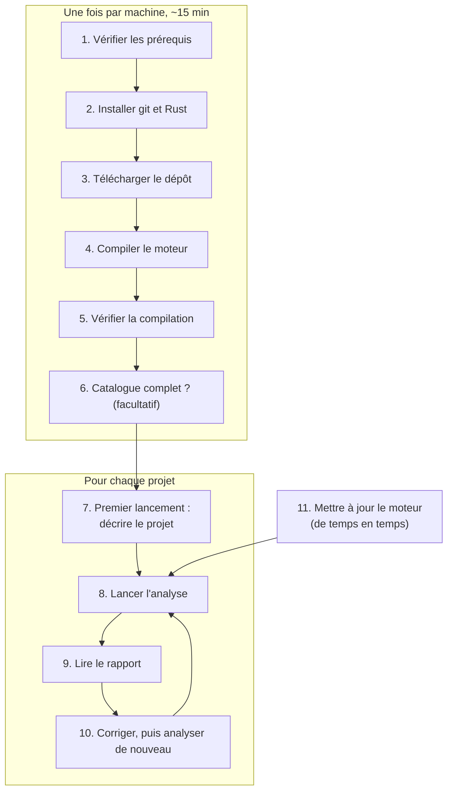
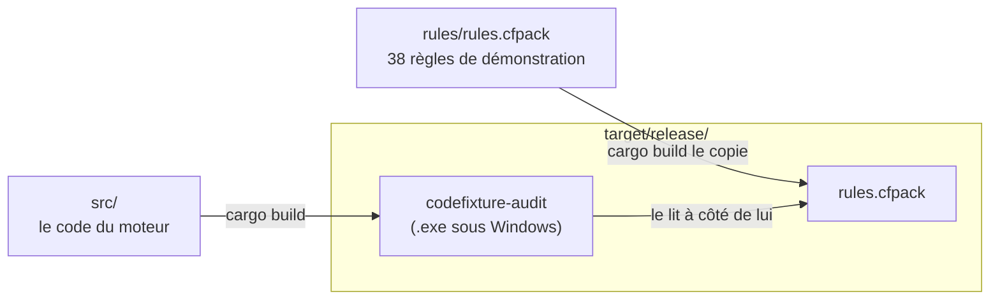
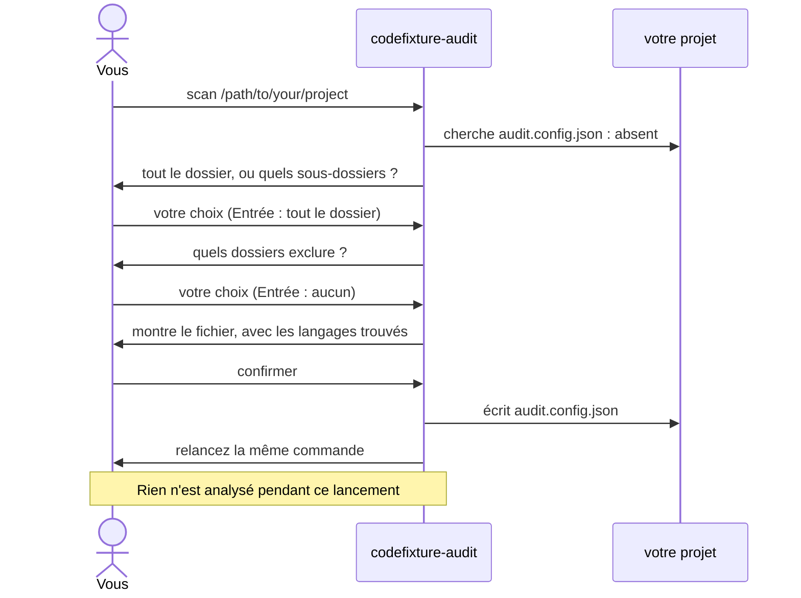
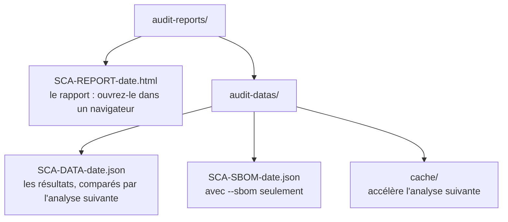
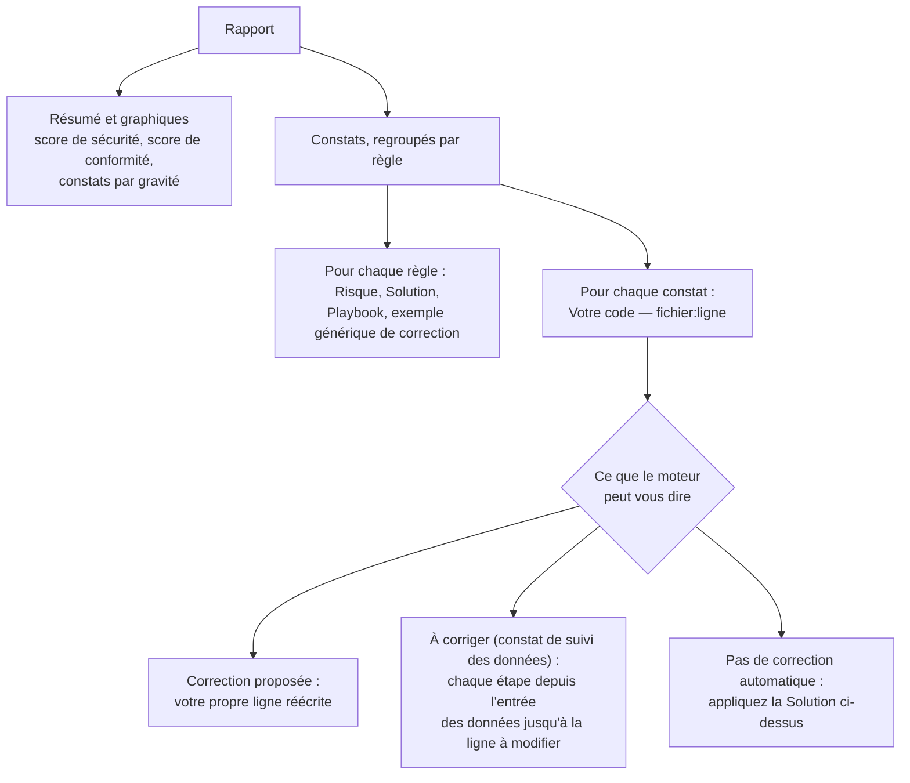
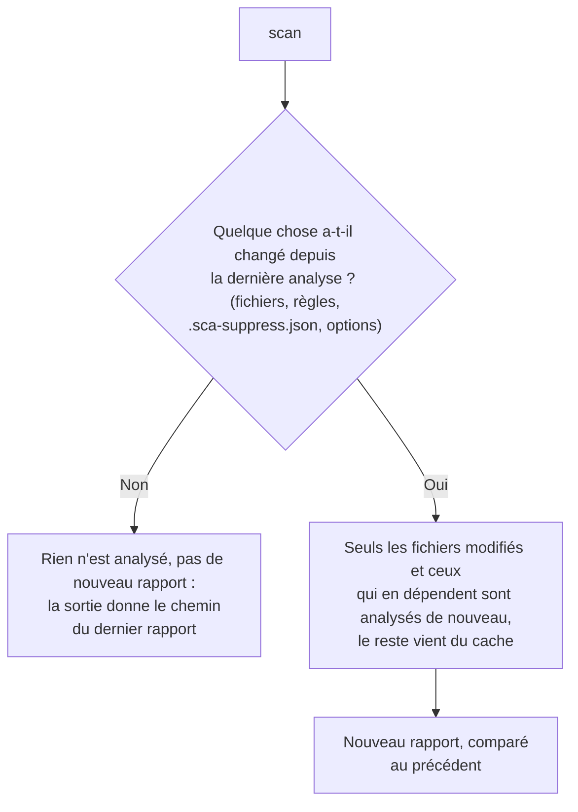
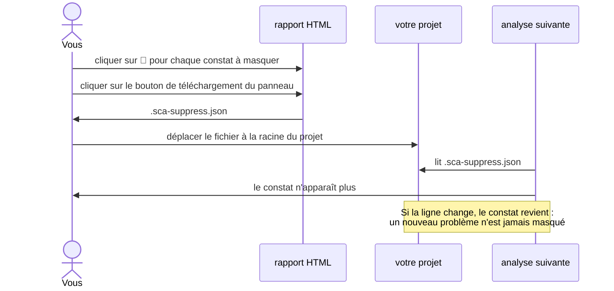
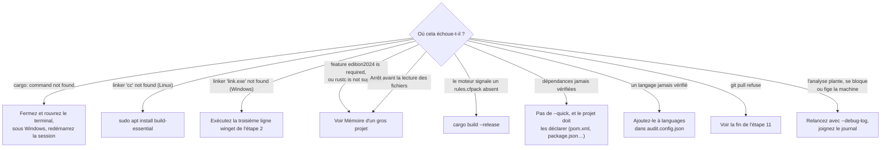

# Du téléchargement à l'analyse complète de votre code

*English version: [INSTALLATION.md](INSTALLATION.md)*

Ce guide vous mène, étape par étape, d'une machine où rien n'est installé à l'analyse complète de votre propre code source sur votre machine, puis à la lecture et à la correction de ce qu'elle trouve. L'analyse s'exécute en local : votre code ne quitte jamais votre ordinateur.



| Étape | Ce que vous faites | Durée |
|---|---|---|
| [1](#étape-1--vérifier-les-prérequis) | Vérifier les prérequis | 1 min |
| [2](#étape-2--installer-les-outils) | Installer les outils (`git`, Rust) | 5 à 10 min, une seule fois |
| [3](#étape-3--télécharger-le-dépôt) | Télécharger le dépôt | 1 min |
| [4](#étape-4--compiler-le-moteur) | Compiler le moteur | 3 à 10 min la première fois |
| [5](#étape-5--vérifier-la-compilation) | Vérifier la compilation | 1 min |
| [6](#étape-6--ajouter-le-catalogue-complet-facultatif) | Ajouter le catalogue complet (facultatif) | 1 min de lecture |
| [7](#étape-7--décrire-votre-projet-premier-lancement) | Décrire votre projet (premier lancement) | 2 min, une fois par projet |
| [8](#étape-8--lancer-une-analyse) | Lancer une analyse | de quelques secondes à quelques minutes |
| [9](#étape-9--lire-le-rapport) | Lire le rapport | — |
| [10](#étape-10--corriger-et-analyser-de-nouveau) | Corriger et analyser de nouveau | — |
| [11](#étape-11--mettre-à-jour-le-moteur) | Mettre à jour le moteur | 2 min |

Lisez d'abord les [Limites connues](#limites-connues) : le moteur est testé sur macOS et Linux, pas encore sur Windows, et la première analyse d'un projet demande deux lancements.

Les commandes sont données pour macOS et Linux (Terminal) et pour Windows (PowerShell). Remplacez `/path/to/your/project` (ou `C:\path\to\your\project`) par le dossier du code que vous voulez analyser.

## Limites connues

Voici les cas où le moteur peut ne pas se comporter comme vous l'attendez, avec ce qu'il faut faire.

- **Pas encore testé sous Windows.** Chaque étape de ce guide a été exécutée sur macOS et sur Linux (Ubuntu 24.04). Les commandes Windows sont données, mais vous serez peut-être le premier à les exécuter. Si une étape échoue, notez la commande et le message complet qu'elle a affiché, et envoyez-les à CodeFixture.
- **La première analyse demande deux lancements.** La première fois que vous analysez un projet, le moteur demande quoi analyser (étape 7), écrit `audit.config.json` et s'arrête sans rapport. C'est normal : relancez la même commande. Dans un script ou une tâche de CI, aucune question n'est posée et le premier lancement produit le rapport.
- **Les règles de démonstration donnent un rapport maigre.** Les 38 règles de démonstration de ce dépôt couvrent une petite partie de ce que le moteur détecte. Sur un vrai projet, leurs constats peuvent venir surtout de quelques règles, comme le JavaScript écrit dans les attributs HTML (`onclick=…`). Le catalogue complet (étape 6) donne le rapport complet.
- **Le pack de démonstration connaît peu de vulnérabilités publiées.** Vos dépendances sont comparées aux vulnérabilités publiées que porte le pack de règles : 21 vulnérabilités bien connues dans le pack de ce dépôt (Log4Shell, Spring4Shell, lodash, lxml…). Une dépendance que le rapport ne nomme pas peut quand même être touchée par une autre. Le catalogue complet (étape 6) les compare à toutes les vulnérabilités publiées des cinq écosystèmes, à la date du dernier téléchargement de ses données.
- **Certains constats n'ont pas de correction automatique.** Quand le moteur ne peut pas réécrire votre ligne sans risque, le rapport le dit et donne la solution en mots, avec un exemple générique. La correction de la ligne vous revient alors.
- **Un constat peut être une fausse alerte.** Si un constat est faux (la valeur est déjà vérifiée, ou ne peut pas venir d'un utilisateur), masquez-le avec 🚫 (étape 10) et signalez-le : cela aide à améliorer les règles.
- **Un gros projet demande beaucoup de mémoire.** Suivre une donnée d'un fichier à l'autre garde tout le projet en mémoire : environ 20 fois la taille de ses sources Python, Java, JavaScript, PHP et C# (5 Go pour 250 Mo de Java). L'analyse l'estime avant de lire les fichiers, l'affiche, et s'arrête quand la machine ne l'a pas de disponible, pour que le système n'échange pas sur le disque et ne se fige pas. Voir [Mémoire d'un gros projet](#mémoire-dun-gros-projet).
- **La première installation prend du temps.** L'installation de Rust et la première compilation prennent environ 10 à 15 minutes (étapes 2 et 4). Les compilations et analyses suivantes sont bien plus rapides ; une nouvelle analyse d'un projet inchangé prend moins d'une seconde et n'écrit pas de nouveau rapport.

## Étape 1 : vérifier les prérequis

- macOS 12 ou plus récent, Linux (testé sur Ubuntu 24.04) ou Windows 10/11.
- Environ 6 Go d'espace disque libre : la compilation écrit environ 5 Go de fichiers intermédiaires dans `target/`.
- Une connexion internet pour les étapes 2, 3 et 11 seulement. L'analyse elle-même ne fait aucun appel réseau.

## Étape 2 : installer les outils

Deux outils sont utilisés : `git` télécharge le dépôt et ses mises à jour, `cargo` (Rust) compile le moteur à partir du code.

**macOS**, dans l'application **Terminal** :

```bash
xcode-select --install
curl --proto '=https' --tlsv1.2 -sSf https://sh.rustup.rs | sh
```

`xcode-select` installe `git` avec les outils de développement d'Apple. La ligne `curl` installe Rust : appuyez sur Entrée quand il demande quelle installation utiliser.

**Linux** (Debian, Ubuntu), dans un terminal :

```bash
sudo apt install build-essential git curl
curl --proto '=https' --tlsv1.2 -sSf https://sh.rustup.rs | sh
```

`build-essential` apporte le compilateur C dont la compilation a besoin : sans lui, l'étape 4 s'arrête sur `linker 'cc' not found`. Sur une autre distribution, installez son paquet de compilateur C (`gcc`), `git` et `curl`.

N'utilisez pas les paquets `cargo` et `rustc` de votre distribution : Ubuntu 24.04 fournit Rust 1.75, et le moteur demande Rust 1.89 ou plus récent. S'ils sont installés, retirez-les d'abord avec `sudo apt remove cargo rustc` : ils sont dans `/usr/bin` et passeraient avant le Rust qu'installe rustup.

**Windows**, dans **PowerShell** :

```powershell
winget install Git.Git
winget install Rustlang.Rustup
winget install Microsoft.VisualStudio.2022.BuildTools --override "--wait --passive --add Microsoft.VisualStudio.Workload.VCTools --includeRecommended"
```

La troisième ligne installe les outils de compilation C++ dont Rust a besoin sous Windows.

Ensuite, **fermez et rouvrez** le terminal ou PowerShell, pour qu'il trouve les nouveaux outils. Vérifiez :

```bash
git --version
cargo --version
```

Chaque commande affiche un numéro de version. `cargo --version` doit afficher 1.89 ou plus : une version plus ancienne vient d'une autre installation de Rust (`which -a cargo` les liste) ; retirez-la, puis lancez `rustup update stable`. Si l'une répond « command not found », rouvrez encore la fenêtre ; sous Windows, redémarrez la session.

## Étape 3 : télécharger le dépôt

```bash
cd ~
git clone https://github.com/ka8t/codefixture-audit-public.git
cd codefixture-audit-public
```

`git clone` copie le dépôt dans un nouveau dossier, `codefixture-audit-public`, dans votre dossier personnel. Toutes les commandes suivantes s'exécutent depuis ce dossier.

## Étape 4 : compiler le moteur

```bash
cargo build --release
```

La première compilation télécharge les bibliothèques Rust qu'utilise le moteur et compile le tout : 3 à 10 minutes selon la machine. Elle se termine par une ligne `Finished`. Le moteur est alors `target/release/codefixture-audit` (`target\release\codefixture-audit.exe` sous Windows), à côté du pack de règles `target/release/rules.cfpack`.



## Étape 5 : vérifier la compilation

macOS et Linux :

```bash
./target/release/codefixture-audit --version
./target/release/codefixture-audit list-rules | head -1
```

Windows :

```powershell
.\target\release\codefixture-audit.exe --version
.\target\release\codefixture-audit.exe list-rules | Select-Object -First 1
```

`--version` affiche la version compilée, par exemple `codefixture-audit 0.1.0+42.c5be809` : le nombre de commits et l'empreinte courte du commit indiquent exactement quel code vous avez compilé. Chaque analyse l'affiche aussi sur sa première ligne. `list-rules` affiche le nombre de règles sur sa première ligne : 38 pour les règles de démonstration livrées avec ce dépôt.

Toutes les commandes ci-dessous s'exécutent depuis le dossier `codefixture-audit-public`, avec le chemin complet du moteur.

## Étape 6 : ajouter le catalogue complet (facultatif)

Avec les 38 règles de démonstration, l'analyse fonctionne tout de suite mais couvre une petite partie de ce que le moteur détecte. Le catalogue complet compte plus de 700 règles. Il couvre aussi toutes les vulnérabilités publiées (CVE, GHSA) des cinq écosystèmes, auxquelles vos dépendances sont comparées.

Le catalogue complet n'est pas un fichier à ajouter à ce dépôt. Un testeur ou un client de [CodeFixture](https://codefixture.com) reçoit l'accès à son dépôt privé sur GitHub. Clonez ce dépôt et suivez son propre `docs/INSTALLATION.md`. Sa compilation écrit le catalogue complet à côté du moteur. Son étape 7 télécharge les vulnérabilités publiées sur votre machine. Ses mises à jour se font par `git pull` et une nouvelle compilation, comme à l'étape 11.

Sans cet accès, gardez ce dépôt : les étapes suivantes fonctionnent de la même façon avec les règles de démonstration.

## Étape 7 : décrire votre projet (premier lancement)

La première fois que vous analysez un projet, le moteur vous demande quoi analyser et écrit la réponse dans `audit.config.json`, à la racine du projet :

macOS et Linux :

```bash
cd ~/codefixture-audit-public
./target/release/codefixture-audit scan /path/to/your/project --lang en
```

Windows :

```powershell
cd ~\codefixture-audit-public
.\target\release\codefixture-audit.exe scan C:\path\to\your\project --lang en
```



Il demande s'il faut analyser tout le dossier ou certains sous-dossiers, et quels dossiers exclure. Il montre ensuite le fichier avec les langages qu'il a détectés, et l'écrit une fois que vous confirmez. Rien n'est analysé pendant cette étape : relancez la même commande pour l'analyse (étape 8).

Le fichier ressemble à ceci ; vous pouvez le modifier à la main à tout moment :

```json
{ "languages": ["python", "javascript"], "paths": { "include": ["src/"], "exclude": ["src/legacy/"] } }
```

- `languages` : les langages vérifiés. Valeurs acceptées : `python`, `java`, `javascript`, `typescript` (mêmes règles que `javascript`), `php`, `csharp`, `html`, `yaml`, `dockerfile` ; les règles Dockerfile sont toujours ajoutées. Si vous ajoutez plus tard du code dans un autre langage, ajoutez-le ici : d'ici là, chaque analyse avertit qu'aucune règle ne vérifie ces fichiers.
- `paths.include` et `paths.exclude` : les dossiers analysés et ignorés.

Les questions ne sont posées que dans un terminal interactif. Dans un script ou une tâche de CI, le moteur analyse tout le dossier sans rien demander.

## Étape 8 : lancer une analyse

Pour une analyse complète, en anglais :

macOS et Linux :

```bash
cd ~/codefixture-audit-public
./target/release/codefixture-audit scan /path/to/your/project --lang en
```

Windows :

```powershell
cd ~\codefixture-audit-public
.\target\release\codefixture-audit.exe scan C:\path\to\your\project --lang en
```

Pour un rapport en français, en espagnol ou en allemand, remplacez `--lang en` par `--lang fr`, `--lang es` ou `--lang de`.

- `--lang` fixe la langue du rapport : `en`, `fr`, `es` ou `de`.
- Quand votre projet déclare des dépendances (`requirements.txt`, `package.json`, `pom.xml`, `composer.json`…), leurs versions sont comparées, hors ligne, aux vulnérabilités publiées que porte le pack de règles ; la sortie nomme le pack, la date de ses données et ses effectifs. La version comparée est celle que donne le fichier de verrouillage voisin du manifeste (`package-lock.json`, `poetry.lock`, `composer.lock`…), sinon la version exacte que fixe le manifeste, sinon la plus petite version qu'autorise un intervalle (`>=2.0` donne 2.0), que le constat indique avec l'intervalle. Une contrainte sans borne inférieure, comme `<2.0`, est signalée comme non fixée. Les dépendances Maven, Gradle et NuGet ne sont comparées que si leur version est exacte. Les paquets qu'un fichier de verrouillage installe en plus des dépendances déclarées sont aussi comparés. Dans le constat, chaque vulnérabilité donne sa gravité, puis `exploited in attacks, CISA KEV since <date>` quand le catalogue Known Exploited Vulnerabilities de la CISA la répertorie, et `EPSS <n>%`, la probabilité calculée par FIRST qu'elle soit exploitée dans les 30 prochains jours. Une vulnérabilité exploitée rend le constat critique, quelle que soit sa gravité ; le score EPSS ne change rien. Les bases de ces données et leurs licences sont listées dans le tableau de périmètre du rapport et dans le [README](README.fr.md#données-de-vulnérabilités).
- `--sbom` écrit aussi la liste de vos dépendances déclarées dans un fichier CycloneDX : voir [Export SBOM](#export-sbom).

Le terminal affiche l'avancement, ce qui a été chargé et un résumé. Voici l'analyse d'OWASP Juice Shop avec les règles de démonstration de ce dépôt :

```text
[codefixture-audit] codefixture-audit 0.1.0+54.171ec77
[codefixture-audit] Scope (audit.config.json): include the whole project; exclude 7 default patterns
[codefixture-audit] Analysis in progress...
…
[codefixture-audit] Rules: 23/38 rule file(s) kept for the project's languages, from the pack /…/target/release/rules.cfpack
[codefixture-audit] 23 rule(s) loaded for languages: dockerfile, html, javascript, python, yaml
…
[codefixture-audit] Version rules: 26 published vulnerabilities from the rule pack /…/target/release/rules.cfpack, OSV data up to 2026-11-18T12:11:06.983073747Z: Maven 5, NuGet 3, Packagist 3, PyPI 10, npm 5.
[codefixture-audit] Report generated : /path/to/your/project/audit-reports/SCA-REPORT-2026-11-20-13-17.html
[codefixture-audit] 871 file(s) scanned, 91999 line(s) of code, 31 finding(s)
```

Les options s'ajoutent à la même commande, par exemple `./target/release/codefixture-audit scan /path/to/your/project --lang en --no-cache` :

| Option | Effet |
|---|---|
| `--lang en\|fr\|es\|de` | langue du rapport |
| `--no-cache` | analyse de nouveau tout le projet (voir l'étape 10) |
| `--format sarif` | écrit un fichier SARIF au lieu du rapport HTML, pour un IDE ou une plateforme de code ; il est affiché dans le terminal, redirigez-le avec `> result.sarif` |
| `--exclude 'tests/'` | ignore d'autres fichiers (option répétable) |
| `--only-category security` | n'analyse qu'une catégorie (la liste : `./target/release/codefixture-audit list-rules`) |
| `--quick` | saute la vérification des dépendances, pour une analyse plus rapide |
| `--rules <file>` | utilise un autre pack de règles que celui placé à côté du moteur |

## Étape 9 : lire le rapport

Ouvrez dans un navigateur le fichier nommé sur la ligne `Report generated`. Le rapport est écrit dans votre projet, sous `audit-reports/` ; ne committez pas ce dossier, il contient les résultats.





Le rapport commence par un résumé et des graphiques, puis liste les constats par gravité, catégorie et règle. Pour chaque règle, un bloc commun explique :

- **Risque** : ce qui peut mal tourner ;
- **Solution** : comment corriger ;
- **Playbook** : les étapes pour trouver, corriger et vérifier ;
- **Exemple générique de correction** : un exemple avant/après écrit pour la règle, pas pour votre code.

Ensuite, chaque constat montre, dans cet ordre :

1. **Votre code — `fichier:ligne`** : la ligne trouvée dans votre projet, surlignée, avec les lignes qui l'entourent.
2. L'un de ces trois blocs :
   - **Correction proposée** : votre propre ligne réécrite, quand la règle connaît une réécriture sûre. Une note indique quand l'adapter (par exemple `type="submit"` pour un bouton qui envoie un formulaire) ;
   - **À corriger**, pour un constat de suivi des données (analyse de taint) : chaque étape depuis l'endroit où les données entrent (par exemple un paramètre HTTP) jusqu'à la ligne où elles sont utilisées, chacune avec son fichier, sa ligne et son code, la ligne à modifier et ce qu'il faut y faire ;
   - **Pas de correction automatique pour cette règle** : appliquez la Solution ci-dessus ; l'exemple générique montre l'idée.

Le bouton 🚫 d'un constat le marque comme fausse alerte ou comme risque accepté ; voir l'étape 10.

## Étape 10 : corriger et analyser de nouveau

Corrigez votre code, puis lancez la même commande qu'à l'étape 8. Chaque analyse garde une copie de ses résultats dans `audit-reports/audit-datas/` et les compare à la précédente : le rapport montre ce qui a été corrigé, ce qui est nouveau et ce qui reste.



L'analyse suivante est bien plus rapide : elle ne refait que les fichiers que vous avez modifiés et ceux qui en dépendent, et reprend le reste depuis `audit-reports/audit-datas/cache/`. Deux lignes de la sortie indiquent la part refaite, par exemple `Cache (python): 1/460 file(s) changed since the last scan, 34/10580 taint analyses redone.` Le rapport est identique à celui d'une analyse complète. Chaque version du moteur garde son propre cache dans un sous-dossier qui porte son nom, pour que deux versions utilisées sur le même projet ne s'écrasent pas ; les trois plus récemment utilisées sont gardées. Pour forcer une analyse complète, ajoutez `--no-cache` ; supprimer le dossier `cache/` a le même effet.

Si aucun fichier n'a changé depuis la dernière analyse, rien n'est analysé et aucun nouveau rapport n'est écrit. La sortie le dit et donne le chemin du dernier rapport, par exemple `No file has changed since the scan of 18/11/2026 13:36: nothing was analysed again.` Un fichier, un pack de règles, un `.sca-suppress.json` ou une option modifiés relancent l'analyse. `--format sarif` et `--format text` affichent quand même leur résultat, tiré de la dernière analyse, et `--sbom` donne le chemin du SBOM déjà écrit au lieu d'en écrire un nouveau.

Pour faire taire un constat que vous avez examiné :



1. cliquez sur 🚫 sur le constat dans le rapport (autant de fois que nécessaire), puis sur le bouton de téléchargement du panneau qui apparaît : il enregistre un fichier `.sca-suppress.json` ;
2. déplacez ce fichier à la racine de votre projet.

Les analyses suivantes le lisent d'elles-mêmes.

Une suppression s'applique à cette règle, à ce fichier et à ce contenu de ligne : si la ligne change, le constat revient, pour qu'un nouveau problème ne soit jamais masqué.

## Étape 11 : mettre à jour le moteur

Depuis le dossier `codefixture-audit-public` :

```bash
git pull
cargo build --release
```

`git pull` ne télécharge que les nouveaux commits ; `cargo build --release` recompile le moteur, plus vite que la première fois. Vérifiez avec `--version` : le nombre de commits doit avoir augmenté.

Si `git pull` refuse à cause de modifications locales, `git stash` les met de côté et `git pull` fonctionne alors (`git stash pop` les remet en place). Pour revenir exactement à l'état de GitHub et abandonner définitivement vos modifications locales : `git fetch origin` puis `git reset --hard origin/main`.

## Référence

### Dossiers ignorés par une analyse

En plus de `node_modules/`, `vendor/`, `.venv/`, `__pycache__/`, `*.min.js` et des rapports du moteur lui-même, une analyse ignore les dossiers qui ne contiennent pas de code du projet :

- les sorties de compilation : un dossier `target/` à côté d'un `pom.xml` (Maven), un dossier `build/` à côté d'un `build.gradle` ou d'un `build.gradle.kts` (Gradle) ;
- les environnements virtuels Python, quel que soit leur nom : tout dossier qui contient un fichier `pyvenv.cfg` ;
- la documentation : `docs/`, `doc/`, `documentation/` et `wiki/`, à toute profondeur et quelle que soit la casse.

Après l'analyse, une ligne nomme chaque dossier ainsi ignoré et la raison. Pour analyser quand même l'un d'eux, nommez-le dans `paths.include` de `audit.config.json` : `"include": [".", "docs/"]`. Pour ignorer d'autres dossiers, listez-les dans `paths.exclude`.

### Export SBOM

Un SBOM (nomenclature logicielle, *software bill of materials*) liste les paquets tiers qu'utilise un projet, dans un format standard que lisent les outils de sécurité et de conformité. Ajoutez `--sbom` à une analyse :

```bash
./target/release/codefixture-audit scan /path/to/your/project --lang en --sbom
```

En plus du rapport, le moteur écrit `SCA-SBOM-<date>.json` dans le dossier `audit-reports/audit-datas/` de votre projet et affiche son chemin sur la ligne `SBOM :`. Le fichier suit CycloneDX 1.6, le format de l'OWASP :

- un composant par dépendance déclarée dans `requirements.txt`, `pyproject.toml`, `Pipfile`, `package.json`, `pom.xml`, `build.gradle`, `.csproj` ou `composer.json`, avec son URL de paquet (`pkg:pypi/requests@2.31.0`) ;
- un composant par paquet qu'un fichier de verrouillage installe en plus des dépendances déclarées (une dépendance transitive), avec sa version ;
- une version seulement quand la version installée est connue : celle que donne le fichier de verrouillage, sinon celle que le manifeste fixe exactement. Une dépendance déclarée avec un intervalle (`flask>=2.0`, `"lodash": "^4.17.0"`) et absente de tout fichier de verrouillage, ou sans version, est listée sans version ;
- ni vulnérabilités, ni empreintes, ni licences : les vulnérabilités figurent dans le rapport HTML.

Le préfixe de fichier `SCA` suit `brand.json` quand vous le personnalisez.

### Vos propres règles

Vous pouvez ajouter vos propres règles, pour une API interne ou une convention de votre code : de simples fichiers `.sca` dans `~/.codefixture-audit/custom-rules/` (`%USERPROFILE%\.codefixture-audit\custom-rules\` sous Windows), rangés par langage (`python/security/ma_regle.sca`). Chaque analyse les charge en plus des règles livrées, pour les langages qu'elle analyse ; `--custom-rules-dir <DOSSIER>` lit un autre dossier à la place. Aucune compilation ni mise à jour ne touche ce dossier. Le guide d'écriture des règles, [`RULE-LANGUAGE.fr.md`](RULE-LANGUAGE.fr.md), décrit le langage des règles, les cas de test et la façon dont vos règles apparaissent dans le rapport.

- Le rapport les liste dans sa section « Règles personnalisées », chacune avec son nombre de constats, et étiquette leurs constats comme les vôtres.
- Une de vos règles qui porte le langage et le nom d'une règle livrée la remplace, et l'analyse le dit.
- Une règle qui ne compile pas est nommée dans un avertissement, avec l'erreur, et laissée de côté ; les autres s'exécutent.

Pour en écrire une, laissez le moteur poser les questions :

```bash
./target/release/codefixture-audit custom-rules create --lang fr
```

Il demande le langage, le nom, la catégorie et la gravité, puis ce qu'il faut détecter : un texte à chercher dans le code, ou une donnée suivie depuis son entrée (un paramètre de requête, par exemple) jusqu'à un appel dangereux. Il demande ensuite pourquoi c'est dangereux et comment corriger, affiche la règle, vérifie qu'elle compile, nomme les règles livrées qui cherchent déjà le même texte, et écrit le fichier dans le dossier ci-dessus après votre confirmation. Si vous donnez le nom d'une de vos règles, il propose de la modifier ; si vous donnez le nom d'une règle livrée, il demande avant que la vôtre la remplace, et sinon demande un autre nom. Il a besoin d'un terminal : des réponses envoyées depuis un fichier sont refusées.

Avec la règle, il écrit deux cas de test dans `cases/` du même dossier : un fichier vulnérable que la règle doit signaler et un fichier propre qu'elle ne doit pas signaler, listés dans `cases/registry.json`. Si vous avez donné un exemple de code (le code vulnérable et sa version corrigée), les cas sont cet exemple et passent aussitôt ; sinon, chacun est un commentaire à remplacer par du code, et le cas vulnérable échoue tant que vous ne l'avez pas fait. Lancez les cas de toutes les règles, ou d'une seule :

```bash
./target/release/codefixture-audit custom-rules test --lang fr
./target/release/codefixture-audit custom-rules test python/ma_regle --lang fr
```

Chaque cas en échec est nommé avec sa raison (`ÉCHEC ma_regle_python_clean (python/ma_regle, clean) : aucune alerte attendue, levée lignes [3] — clean/python/ma_regle_clean.py`), puis viennent les comptes. Le code de sortie vaut 0 quand tous les cas passent, 1 quand l'un échoue, 2 quand le registre manque ou n'est pas cohérent (un fichier qu'il liste manque, un fichier de `cases/` n'appartient à aucun cas) ; `--json` donne le résultat en JSON. Une règle sans cas qu'elle doit signaler, ou sans cas qu'elle ne doit pas signaler, est nommée après les comptes.

Pour mettre une règle au point sur du vrai code, lancez-la sur un projet : chaque ligne qu'elle signale s'affiche, sans rapport ; une ligne qu'une règle livrée signale aussi s'affiche avec le nom de cette règle. Sur une telle ligne, le rapport garde le constat de la règle livrée, et chaque analyse nomme votre règle et la règle livrée avec laquelle elle fait doublon. Les règles livrées viennent de `rules.cfpack`, à côté de l'exécutable, comme pour `scan` ; `--rules <dossier ou pack>` en lit d'autres.

```bash
./target/release/codefixture-audit custom-rules try python/ma_regle /chemin/vers/votre/projet --lang fr
```

### Mémoire d'un gros projet

Chaque analyse affiche la mémoire qu'elle prévoit, par exemple `Mémoire : environ 5,4 Go prévus.`, puis ce que la machine a de disponible. L'estimation est faite avant de lire le moindre fichier, d'après la taille des fichiers : environ 20 fois les sources des langages dont les données sont suivies (Python, Java, JavaScript, PHP, C#), 6 fois les autres.

Quand la mémoire est juste, l'analyse fait d'abord tourner moins de règles de suivi de données à la fois : elle prend alors moins de mémoire et plus de temps (jusqu'à la moitié en plus environ), et le dit (`Pour tenir en mémoire, 2 règle(s) de suivi de données tournent à la fois au lieu de 4`). Quand l'estimation dépasse encore la mémoire disponible avec une seule règle à la fois, l'analyse s'arrête aussitôt, avec le code de sortie 2 et sans rapport, et dit pourquoi, quelles sources elle aurait lues, et quoi faire :

- analyser le projet module par module (chaque sous-dossier à part) ;
- écarter des dossiers avec `paths.exclude` dans `audit.config.json` (code généré, tests, copies de bibliothèques) ;
- fermer d'autres programmes, puis relancer ;
- lancer quand même avec `--skip-memory-check`, en sachant que le système peut échanger sur le disque et se figer.

Par défaut, l'analyse prend au plus 75 % de la mémoire installée, et `--max-memory` fixe une autre borne, en Go ou en part de la mémoire installée : voir [Fils d'exécution et mémoire de l'analyse](#fils-dexécution-et-mémoire-de-lanalyse). La mémoire disponible est lue sous Linux, macOS et Windows ; sur un système qui ne l'indique pas, seul `--max-memory` en Go borne l'analyse.

### Fils d'exécution et mémoire de l'analyse

Par défaut, l'analyse laisse de la place sur la machine pour le reste du travail : elle tourne sur tous les cœurs sauf un, et prend au plus 75 % de la mémoire installée (12 Go d'une machine de 16 Go), moins quand il y en a moins de disponible. Chaque analyse dit ce qu'elle utilise :

```text
[codefixture-audit] Mémoire : environ 4,6 Go prévus.
[codefixture-audit] Cette machine a 13,0 Go disponibles sur 16,0 Go.
[codefixture-audit] Plafond : 12,0 Go (par défaut : 75 % de la mémoire installée).
[codefixture-audit] Fils d'exécution : 7 sur 8 cœurs (par défaut : tous les cœurs sauf un).
```

Deux options le changent, chacune en nombre ou en part de la machine :

| Option | Effet |
|---|---|
| `--cpu 4`, `--cpu 50%` | au plus 4 fils d'exécution, ou la moitié des cœurs (arrondi à l'inférieur, au moins 1). Moins de fils d'exécution font aussi tourner moins de règles de suivi de données à la fois, et prennent donc un peu moins de mémoire. `--cpu 100%` prend tous les cœurs ; un nombre supérieur aux cœurs est ramené à eux. |
| `--max-memory 8`, `--max-memory 50%` | au plus 8 Go (avec un point pour les décimales : `7.5`), ou la moitié de la mémoire installée. Au-delà, l'analyse fait d'abord tourner moins de règles de suivi de données à la fois, puis s'arrête avant de lire les fichiers (voir [Mémoire d'un gros projet](#mémoire-dun-gros-projet)). `--max-memory 100%` lève le plafond par défaut. |

Moins de fils d'exécution rendent l'analyse plus longue, jamais différente : les résultats sont les mêmes. Mesuré sur le projet de référence `Java` (20 680 fichiers, une machine de 8 cœurs, 2026-11-24) : 101 s avec les 7 fils d'exécution par défaut, 139 s avec `--cpu 50%`, 353 s avec `--cpu 1` ; un pic de mémoire de 4,6, 4,2 et 4,1 Go ; les mêmes 14 627 résultats.

Une valeur que le moteur ne comprend pas (`0`, `150%`, `7,5`, `8GB`) l'arrête aussitôt, avec le code de sortie 2 et un message qui nomme l'option et la valeur.

Pour fixer les limites une fois pour toutes les analyses d'une machine, utilisez les variables d'environnement `CODEFIXTURE_AUDIT_CPU` et `CODEFIXTURE_AUDIT_MAX_MEMORY`, avec les mêmes valeurs que les options. Une option sur la ligne de commande l'emporte sur sa variable, et la console dit d'où vient chaque limite (`fixé par --cpu 2`, `fixé par la variable d'environnement CODEFIXTURE_AUDIT_CPU=50%`, `par défaut`). Le `audit.config.json` du projet ne contient aucune limite : il appartient au projet, les limites à la machine.

- macOS (zsh, le shell par défaut) : `echo 'export CODEFIXTURE_AUDIT_CPU=50%' >> ~/.zshrc`, puis ouvrez un nouveau terminal.
- Linux (bash) : `echo 'export CODEFIXTURE_AUDIT_CPU=50%' >> ~/.bashrc`, puis ouvrez un nouveau terminal ; `~/.profile` la fixe plutôt pour toutes les sessions, graphiques comprises.
- Windows : `setx CODEFIXTURE_AUDIT_CPU 50%` dans PowerShell ou l'invite de commandes, puis ouvrez un nouveau terminal (`setx` enregistre la variable pour votre utilisateur ; le terminal où elle a été lancée garde l'ancienne valeur). Même chose par Paramètres, Système, Informations système, Paramètres avancés du système, Variables d'environnement.

De même pour `CODEFIXTURE_AUDIT_MAX_MEMORY`. Pour une seule analyse : `CODEFIXTURE_AUDIT_CPU=2 ./target/release/codefixture-audit scan …` sous macOS et Linux, `$env:CODEFIXTURE_AUDIT_CPU = "2"` avant la commande dans PowerShell.

### Si l'analyse plante ou fige la machine

Relancez-la avec un journal de débogage :

```bash
./target/release/codefixture-audit scan /chemin/vers/votre/projet --debug-log
```

Le journal va dans `audit-reports/audit-datas/logs/scan-<date>.log.gz` du projet ; la première ligne de l'analyse le nomme. `--debug-log=scan.log` (avec le `=`) écrit à la place un fichier texte de votre choix.

Le journal trace chaque étape, une ligne par étape : chaque dossier et fichier trouvé ou écarté, et pourquoi, chaque règle compilée, chaque fichier lu et analysé, chaque règle passée sur chaque fichier, le suivi de données de chaque règle (son graphe d'appels, ses résumés, chaque fichier), le rapport. Chaque ligne donne l'heure à la milliseconde, le temps écoulé depuis le début, le fil d'exécution, et la mémoire que prend le moteur. Toutes les 2 secondes, quoi qu'il arrive, une ligne `heartbeat` donne la mémoire et liste chaque étape en cours avec sa durée.

Il est écrit au fil de l'analyse : une analyse qui plante, qui est tuée (par le système quand la mémoire manque, ou à la main), ou une machine qui se fige et qu'il faut redémarrer, laisse toutes les lignes écrites jusqu'à ses dernières secondes.

Le fichier est un gzip fait de plusieurs membres, un fermé chaque seconde, que tout lecteur gzip lit l'un après l'autre. Pour le lire sous macOS et Linux : `gzip -dc scan-<date>.log.gz | less`. Sous Windows : la même commande dans Git Bash (installé avec Git for Windows), ou ouvrez-le avec 7-Zip. Après une analyse tuée, `gzip` finit par `unexpected end of file` : c'est attendu, toutes les lignes d'avant sont là, à la dernière seconde près au plus. Si même la dernière seconde compte, lancez avec `--debug-log=scan.log` : le texte brut garde chaque ligne jusqu'à la toute fin. Les dernières lignes `heartbeat` disent ce que faisait l'analyse et combien de mémoire elle prenait.

Joignez le journal à votre retour, avec la commande et ce qu'a affiché le terminal. Il nomme les dossiers, fichiers et règles de votre projet et contient votre `audit.config.json`, jamais votre code.

Le journal coûte un peu de temps : sur OWASP DVWA (187 fichiers), environ 5 % de temps de processeur en plus (2,77 s contre 2,64 s, médiane de 10 analyses), le même pic de mémoire (environ 120 Mo), et un journal de 19 853 lignes, 3,3 Mo de texte, 0,36 Mo compressé. Un gros projet donne un gros journal : sur la suite Juliet Java (46 793 fichiers, 22 règles de suivi de données), 7,2 millions de lignes, 1,6 Go de texte, 129 Mo compressé, pour environ 6 % de temps de processeur en plus (796 s contre 750 s) et le même pic de mémoire (10 Go). Sans `--debug-log`, rien n'est écrit et l'analyse prend le même temps qu'avant.

### Déplacer le moteur

Le moteur et `rules.cfpack` sont tout ce dont une analyse a besoin : copiez-les ensemble dans un autre dossier et lancez le moteur depuis n'importe où. Sans le pack à côté de lui, le moteur s'arrête et nomme le fichier qu'il a cherché.

### En cas de problème



| Message ou symptôme | Que faire |
|---|---|
| `cargo: command not found` | fermez et rouvrez le terminal (étape 2) ; sous Windows, redémarrez la session |
| `linker 'cc' not found` (Linux) | le compilateur C manque : installez `build-essential` (étape 2) |
| `linker 'link.exe' not found` (Windows) | les outils de compilation C++ manquent : exécutez la troisième ligne `winget` de l'étape 2 |
| `feature edition2024 is required`, ou `rustc … is not supported` | Rust est plus ancien que 1.89 : retirez le Rust de votre distribution (`sudo apt remove cargo rustc`), puis lancez `rustup update stable` (étape 2) |
| le moteur s'arrête et signale un `rules.cfpack` absent | relancez `cargo build --release` : la commande remet le pack à côté du moteur |
| les dépendances ne sont jamais vérifiées | le projet n'en déclare aucune dans un fichier que lit le moteur (`requirements.txt`, `package.json`, `pom.xml`, `composer.json`, `.csproj`…), ou `--quick` a été donné |
| un langage de votre projet n'est jamais vérifié | ajoutez-le à `languages` dans `audit.config.json` (étape 7) |
| `git pull` refuse | voir la fin de l'étape 11 |
| `Arrêt avant la lecture des fichiers` | le projet demande plus de mémoire que la machine n'en a de disponible : voir [Mémoire d'un gros projet](#mémoire-dun-gros-projet) |
| l'analyse plante, s'arrête sans rien dire, se bloque ou fige la machine | relancez-la avec `--debug-log` et joignez le journal : voir [Si l'analyse plante ou fige la machine](#si-lanalyse-plante-ou-fige-la-machine) |

Les versions antérieures à novembre 2026 écrivaient leurs rapports dans `docs/audit-reports/`. La première analyse après la mise à jour compare encore avec les derniers résultats trouvés là, puis n'écrit plus que dans `audit-reports/` ; vous pouvez ensuite supprimer l'ancien dossier.
