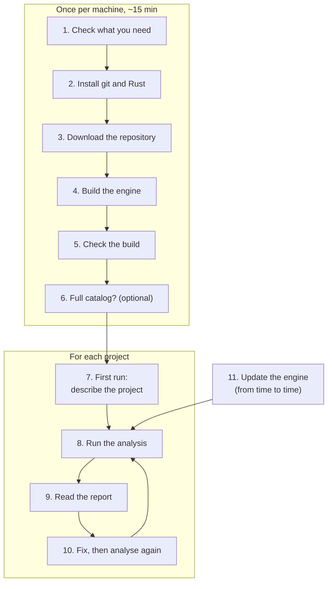
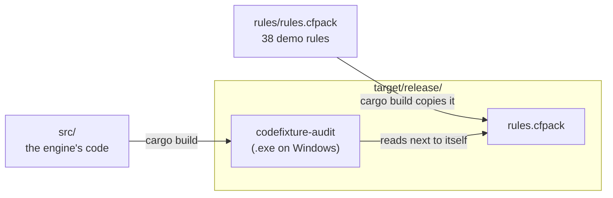
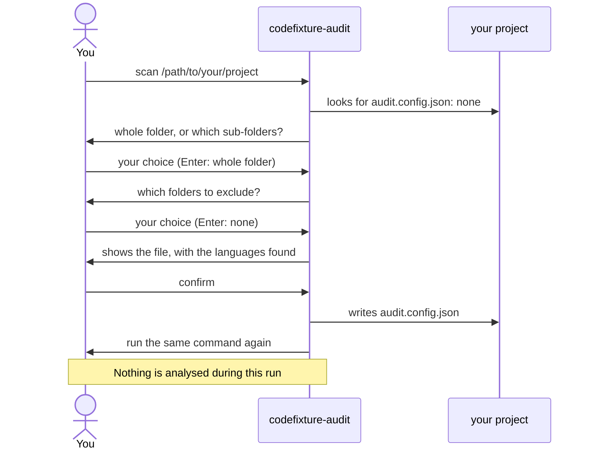
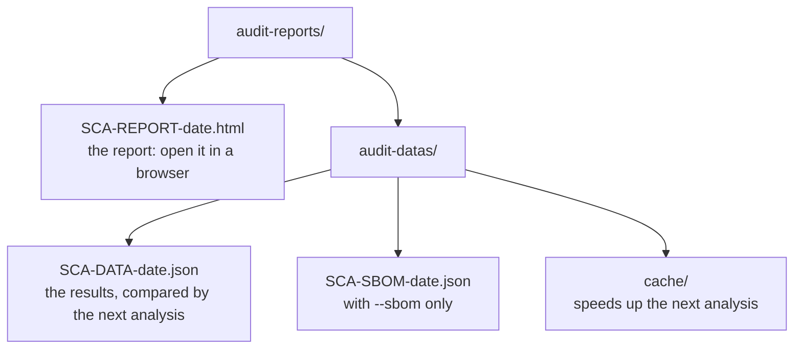
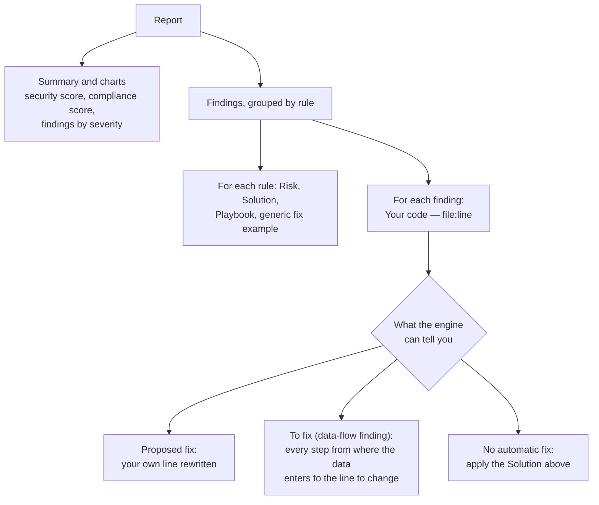
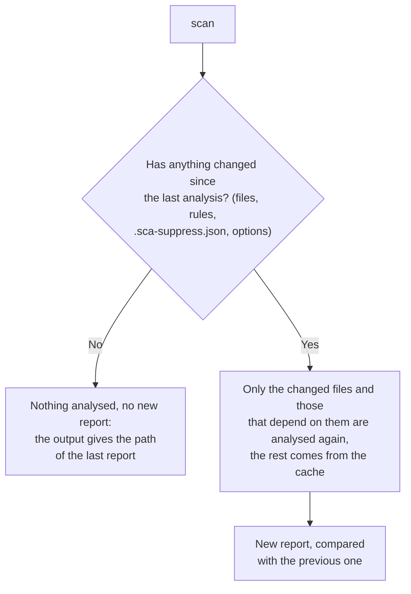
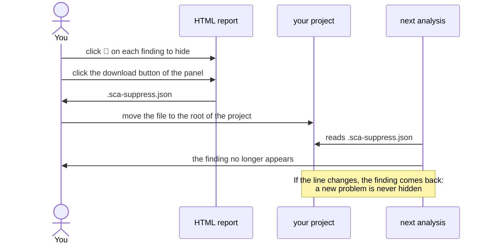
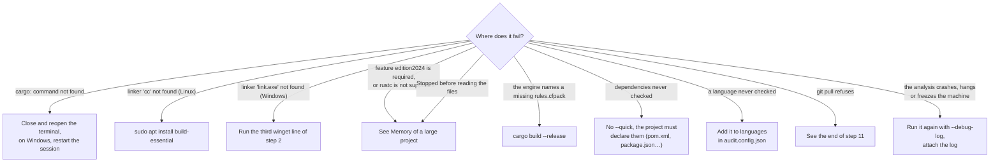

# From download to a full analysis of your code

*Version française : [INSTALLATION.fr.md](INSTALLATION.fr.md)*

This guide takes you, step by step, from nothing installed to a complete analysis of your own source code on your machine, then through reading and fixing what it finds. The analysis runs locally: your code never leaves your computer.



| Step | What you do | Time |
|---|---|---|
| [1](#step-1-check-what-you-need) | Check what you need | 1 min |
| [2](#step-2-install-the-tools) | Install the tools (`git`, Rust) | 5–10 min, once |
| [3](#step-3-download-the-repository) | Download the repository | 1 min |
| [4](#step-4-build-the-engine) | Build the engine | 3–10 min the first time |
| [5](#step-5-check-the-build) | Check the build | 1 min |
| [6](#step-6-add-the-full-catalog-optional) | Add the full catalog (optional) | 1 min to read |
| [7](#step-7-describe-your-project-first-run) | Describe your project (first run) | 2 min, once per project |
| [8](#step-8-run-the-analysis) | Run the analysis | seconds to a few minutes |
| [9](#step-9-read-the-report) | Read the report | — |
| [10](#step-10-fix-and-analyse-again) | Fix and analyse again | — |
| [11](#step-11-update-the-engine) | Update the engine | 2 min |

Read [Known limits](#known-limits) first: the engine is tested on macOS and Linux, not yet on Windows, and the first analysis of a project takes two runs.

Commands are given for macOS and Linux (Terminal) and Windows (PowerShell). Replace `/path/to/your/project` (or `C:\path\to\your\project`) with the folder of the code you want to analyse.

## Known limits

These are the cases where the engine may not behave as you expect, with what to do.

- **Not yet tested on Windows.** Every step of this guide was run on macOS, and on Linux (Ubuntu 24.04). The Windows commands are given, but you may be the first to run them. If a step fails, note the command and the full message it printed, and send them to CodeFixture.
- **The first analysis takes two runs.** The first time you analyse a project, the engine asks what to analyse (step 7), writes `audit.config.json`, and stops without a report. This is expected: run the same command again. In a script or a CI job there are no questions and the first run produces the report.
- **The demo rules give a thin report.** The 38 demonstration rules of this repository cover a small part of what the engine detects. On a real project their findings may come mostly from a few rules, such as JavaScript written in HTML attributes (`onclick=…`). The full catalog (step 6) gives the complete report.
- **The demo pack knows few published vulnerabilities.** Your dependencies are compared with the published vulnerabilities the rule pack carries: 21 well-known ones in this repository's pack (Log4Shell, Spring4Shell, lodash, lxml…). A dependency the report does not name may still be affected by another one. The full catalog (step 6) checks them against every published vulnerability of the five ecosystems, as of the day its data was last downloaded.
- **Some findings have no automatic fix.** When the engine cannot rewrite your line safely, the report says so and gives the solution in words, with a generic example. Fixing the line is then up to you.
- **A finding can be a false positive.** If a finding is wrong (the value is already checked, or cannot come from a user), hide it with 🚫 (step 10) and report it: it helps improve the rules.
- **A large project takes a lot of memory.** Following data from file to file keeps the whole project in memory: about 20 times the size of its Python, Java, JavaScript, PHP and C# sources (5 GB for 250 MB of Java). The analysis estimates it before reading the files, prints it, and stops when the machine does not have it available, so that the system does not swap and freeze. See [Memory of a large project](#memory-of-a-large-project).
- **First installation takes time.** Installing Rust and the first build take about 10 to 15 minutes (steps 2 and 4). Later builds and analyses are much faster; a re-run on an unchanged project takes less than a second and writes no new report.

## Step 1: check what you need

- macOS 12 or later, Linux (tested on Ubuntu 24.04), or Windows 10/11.
- About 6 GB of free disk space: the build writes about 5 GB of intermediate files into `target/`.
- An internet connection for steps 2, 3 and 11 only. The analysis itself makes no network call.

## Step 2: install the tools

Two tools are used: `git` downloads the repository and its updates, `cargo` (Rust) builds the engine from the code.

**macOS**, in the **Terminal** app:

```bash
xcode-select --install
curl --proto '=https' --tlsv1.2 -sSf https://sh.rustup.rs | sh
```

`xcode-select` installs `git` with the Apple developer tools. The `curl` line installs Rust: press Enter when it asks which installation to use.

**Linux** (Debian, Ubuntu), in a terminal:

```bash
sudo apt install build-essential git curl
curl --proto '=https' --tlsv1.2 -sSf https://sh.rustup.rs | sh
```

`build-essential` brings the C compiler the build needs: without it, step 4 stops on `linker 'cc' not found`. On another distribution, install its C compiler package (`gcc`), `git` and `curl`.

Do not use the `cargo` and `rustc` packages of your distribution: Ubuntu 24.04 ships Rust 1.75, and the engine needs Rust 1.89 or later. If they are installed, remove them first with `sudo apt remove cargo rustc`: they sit in `/usr/bin` and would run instead of the Rust that rustup installs.

**Windows**, in **PowerShell**:

```powershell
winget install Git.Git
winget install Rustlang.Rustup
winget install Microsoft.VisualStudio.2022.BuildTools --override "--wait --passive --add Microsoft.VisualStudio.Workload.VCTools --includeRecommended"
```

The third line installs the C++ build tools Rust needs on Windows.

Then **close and reopen** the terminal or PowerShell, so that it finds the new tools. Check:

```bash
git --version
cargo --version
```

Each command prints a version number. `cargo --version` must print 1.89 or later: an older version comes from another installation of Rust (`which -a cargo` lists them); remove it, then run `rustup update stable`. If one says "command not found", reopen the window again; on Windows, restart the session.

## Step 3: download the repository

```bash
cd ~
git clone https://github.com/ka8t/codefixture-audit-public.git
cd codefixture-audit-public
```

`git clone` copies the repository into a new folder, `codefixture-audit-public`, in your home folder. Every following command runs from that folder.

## Step 4: build the engine

```bash
cargo build --release
```

The first build downloads the Rust libraries the engine uses and compiles everything: 3 to 10 minutes depending on the machine. It ends with a `Finished` line. The engine is then `target/release/codefixture-audit` (`target\release\codefixture-audit.exe` on Windows), next to the rule pack `target/release/rules.cfpack`.



## Step 5: check the build

macOS and Linux:

```bash
./target/release/codefixture-audit --version
./target/release/codefixture-audit list-rules | head -1
```

Windows:

```powershell
.\target\release\codefixture-audit.exe --version
.\target\release\codefixture-audit.exe list-rules | Select-Object -First 1
```

`--version` prints the build, for example `codefixture-audit 3.1.0+42.c5be809`: the commit count and short commit hash say exactly which code you built. Every analysis prints it on its first line too. `list-rules` prints the number of rules on its first line: 38 for the demonstration rules this repository ships.

Every command below is run from the `codefixture-audit-public` folder, with the engine's full path.

## Step 6: add the full catalog (optional)

With the 38 demonstration rules, the analysis works at once but covers a small part of what the engine detects. The full catalog has more than 700 rules. It also covers every published vulnerability (CVE, GHSA) of the five ecosystems, against which your dependencies are checked.

The full catalog is not a file to add to this repository. A tester or a client of [CodeFixture](https://codefixture.com) is given access to its private repository on GitHub. Clone that repository and follow its own `docs/INSTALLATION.md`. Its build writes the full catalog next to the engine. Its step 7 downloads the published vulnerabilities onto your machine. Its updates are `git pull` and a new build, as in step 11.

Without that access, keep this repository: the steps below work the same with the demonstration rules.

## Step 7: describe your project (first run)

The first time you analyse a project, the engine asks you what to analyse and writes the answer into `audit.config.json`, at the root of the project:

macOS and Linux:

```bash
cd ~/codefixture-audit-public
./target/release/codefixture-audit scan /path/to/your/project --lang en
```

Windows:

```powershell
cd ~\codefixture-audit-public
.\target\release\codefixture-audit.exe scan C:\path\to\your\project --lang en
```



It asks whether to analyse the whole folder or some sub-folders, and which folders to exclude. It then shows the file with the languages it detected, and writes it once you confirm. Nothing is analysed during this step: run the same command again for the analysis (step 8).

The file looks like this; you can edit it by hand at any time:

```json
{ "languages": ["python", "javascript"], "paths": { "include": ["src/"], "exclude": ["src/legacy/"] } }
```

- `languages`: the languages checked. Accepted values: `python`, `java`, `javascript`, `typescript` (same rules as `javascript`), `php`, `csharp`, `html`, `yaml`, `dockerfile`; the Dockerfile rules are always added. If you later add code in another language, add it here: until then, every analysis warns that those files are checked by no rule.
- `paths.include` and `paths.exclude`: the folders analysed and skipped.
- `thresholds.max_high` (optional): how many blocking findings an analysis tolerates before it fails with exit code 1; 0 by default. Blocking means HIGH and CRITICAL, unless `--fail-on` says otherwise; `--max-blocking` overrides this value. A value that is not a whole number of 0 or more (`"3"` in quotes, `-1`) stops the analysis and is named.

The questions are asked only in an interactive terminal. In a script or a CI job, the engine analyses the whole folder without asking.

## Step 8: run the analysis

For a complete analysis, in English:

macOS and Linux:

```bash
cd ~/codefixture-audit-public
./target/release/codefixture-audit scan /path/to/your/project --lang en
```

Windows:

```powershell
cd ~\codefixture-audit-public
.\target\release\codefixture-audit.exe scan C:\path\to\your\project --lang en
```

For a report in French, Spanish or German, replace `--lang en` with `--lang fr`, `--lang es` or `--lang de`.

- `--lang` sets the language of the report: `en`, `fr`, `es` or `de`.
- When your project declares dependencies (`requirements.txt`, `package.json`, `pom.xml`, `composer.json`…), their versions are compared with the published vulnerabilities the rule pack carries, offline; the output names the pack, the date of its data and its counts. The version compared is the one the lockfile next to the manifest gives (`package-lock.json`, `poetry.lock`, `composer.lock`…), else the exact version the manifest pins, else the lowest version a range allows (`>=2.0` gives 2.0), which the finding states with the range. A constraint without a lower bound, such as `<2.0`, is reported as unpinned. Maven, Gradle and NuGet dependencies are compared only when their version is exact. The packages a lockfile installs besides the declared ones are compared too. In the finding, each vulnerability gives its severity, then `exploited in attacks, CISA KEV since <date>` when CISA's catalog of Known Exploited Vulnerabilities lists it, and `EPSS <n>%`, FIRST's probability that it gets exploited in the next 30 days. An exploited vulnerability makes the finding critical, whatever its severity; the EPSS score changes nothing. The databases of this data and their licenses are listed in the report's scope table and in the [README](README.md#vulnerability-data).
- `--sbom` also writes the list of your declared dependencies as a CycloneDX file: see [SBOM export](#sbom-export).

The terminal shows the progress, what was loaded and a summary. Here, the analysis of OWASP Juice Shop with this repository's demonstration rules:

```text
[codefixture-audit] codefixture-audit 3.1.0
[codefixture-audit] Scope (audit.config.json): include the whole project; exclude 7 default patterns
[codefixture-audit] Analysis in progress...
…
[codefixture-audit] Rules: 23/38 rule file(s) kept for the project's languages, from the pack /…/target/release/rules.cfpack
[codefixture-audit] 23 rule(s) loaded for languages: dockerfile, html, javascript, python, yaml
[codefixture-audit] Your rules: none, the folder /…/.codefixture-audit/custom-rules does not exist (default folder; another one: --custom-rules-dir or CODEFIXTURE_AUDIT_CUSTOM_RULES)
…
[codefixture-audit] Version rules: 26 advisory records for 21 published vulnerabilities (21 with a CVE), from the rule pack /…/target/release/rules.cfpack, OSV data up to November 18, 2026: Maven 5, NuGet 3, Packagist 3, PyPI 10, npm 5.
[codefixture-audit] Report generated: /path/to/your/project/audit-reports/SCA-REPORT-2026-11-20-13-17.html
[codefixture-audit] Scan data: /path/to/your/project/audit-reports/audit-datas/SCA-DATA-2026-11-20-13-17.json
[codefixture-audit] 871 file(s) scanned, 91,999 line(s) of code, 31 finding(s)
```

Options are added to the same command, for example `./target/release/codefixture-audit scan /path/to/your/project --lang en --no-cache`:

| Option | Effect |
|---|---|
| `--lang en\|fr\|es\|de` | language of the report |
| `--no-cache` | analyses everything again (see step 10) |
| `--format sarif` | writes a SARIF file instead of the HTML report, for an IDE or a code platform; it is printed to the terminal, redirect it with `> result.sarif`, or give `--output result.sarif`. Each finding carries a fingerprint, so a code platform does not reopen it when its line moves |
| `--output <file>` | writes the report, or the SARIF file, to this file |
| `--quiet` | for a CI job: no progress lines; the version, the paths of the files written, the summary, warnings and errors stay |
| `--metrics-output <file>` | for a CI job: a JSON file of the scan's numbers (files, lines, findings by severity, phase durations, your rules read, exit code) |
| `--log-format json` | for a CI job: one JSON object per console line, for a log collector |
| `--fail-on-new --baseline <file>` | for a CI job: the exit code counts only the findings absent from the `--baseline` scan (the main branch's scan data), which it requires; a finding whose line moved is not new |
| `--fail-on <severity>` | for a CI job: the lowest severity that blocks (`critical`, `high`, `medium`, `low`, `info`); default `high`, i.e. HIGH and CRITICAL |
| `--max-blocking <N>` | for a CI job: how many blocking findings are tolerated before exit code 1; overrides `thresholds.max_high` |
| `--sbom-output <file>` | for a CI job: writes the SBOM to this file, under a name of your choice; implies `--sbom` |
| `--exclude 'tests/'` | skips more files (repeatable) |
| `--only-category security` | analyses one category only (the list: `./target/release/codefixture-audit list-rules`) |
| `--quick` | skips the dependency check, for a faster run |
| `--rules <file>` | uses another rule pack than the one next to the engine |

## Step 9: read the report

Open the file named on the `Report generated` line in a browser. The report is written into your project, under `audit-reports/`; do not commit that folder, it holds the results.





The report starts with a summary and charts, then lists the findings by severity, category and rule. For each rule, a shared block explains:

- **Risk**: what can go wrong;
- **Solution**: how to fix it;
- **Playbook**: the steps to find, fix and check;
- **Generic fix example**: a before/after example written for the rule, not for your code.

Then each finding shows, in this order:

1. **Your code — `file:line`**: the line found in your project, highlighted, with the lines around it.
2. One of these three:
   - **Proposed fix**: your own line rewritten, when the rule knows a safe rewrite. A note says when to adapt it (for example `type="submit"` for a button that submits a form);
   - **To fix**, for a data-flow finding: every step from where the data enters (for example an HTTP parameter) to the line where it is used, each with its file, line and code, the line to change, and what to do there;
   - **No automatic fix for this rule**: apply the Solution above; the generic example shows the idea.

The 🚫 button on a finding marks it as a false positive or an accepted risk; see step 10.

## Step 10: fix and analyse again

Fix your code, then run the same command as in step 8. Each analysis keeps a copy of its results in `audit-reports/audit-datas/` and compares with the previous one: the report shows what was fixed, what is new and what remains.



The next analysis is much faster: it only redoes the files you changed and those that depend on them, and reuses the rest from `audit-reports/audit-datas/cache/`. Two lines of the output say how much was redone, for example `Cache (python): 1/460 file(s) changed since the last scan, 34/10580 taint analyses redone.` The report is the same as with a full analysis. Each version of the engine keeps its own cache in a sub-folder named after it, so two versions used on the same project do not overwrite each other; the three most recently used are kept. To force a full analysis, add `--no-cache`; deleting the `cache/` folder does the same.

If no file has changed since the last analysis, nothing is analysed and no new report is written. The output says so and gives the path of the last report, for example `No file has changed since the scan of 18/11/2026 13:36: nothing was analysed again.` A changed file, rule pack, `.sca-suppress.json` or option runs the analysis again. `--format sarif` and `--format text` still print their result, taken from the last analysis, and `--sbom` gives the path of the SBOM already written instead of writing a new one.

To silence a finding you have reviewed:



1. click 🚫 on the finding in the report (as many as needed), then the download button in the panel that appears: it saves a `.sca-suppress.json` file;
2. move that file to the root of your project.

The next analyses read it by themselves.

A suppression applies to that rule, file and line content: if the line changes, the finding comes back, so that a new problem is never hidden.

## Step 11: update the engine

From the `codefixture-audit-public` folder:

```bash
git pull
cargo build --release
```

`git pull` downloads only the new commits; `cargo build --release` rebuilds the engine, faster than the first time. Check with `--version`: the commit count must have grown.

If `git pull` refuses because of local changes, `git stash` sets them aside and `git pull` then works (`git stash pop` brings them back). To match GitHub exactly and drop your local edits for good: `git fetch origin` then `git reset --hard origin/main`.

## Reference

### Folders an analysis skips

Besides `node_modules/`, `vendor/`, `.venv/`, `__pycache__/`, `*.min.js` and the engine's own reports, an analysis skips folders that hold no project code:

- build output: a `target/` folder next to a `pom.xml` (Maven), a `build/` folder next to a `build.gradle` or `build.gradle.kts` (Gradle);
- Python virtual environments, whatever their name: any folder holding a `pyvenv.cfg` file;
- documentation: `docs/`, `doc/`, `documentation/` and `wiki/`, at any depth and in any case.

After the analysis, one line names each folder skipped this way and why. To analyse one of them anyway, name it in `paths.include` of `audit.config.json`: `"include": [".", "docs/"]`. To skip more folders, list them in `paths.exclude`.

### SBOM export

An SBOM (software bill of materials) lists the third-party packages a project uses, in a standard format that security and compliance tools read. Add `--sbom` to an analysis:

```bash
./target/release/codefixture-audit scan /path/to/your/project --lang en --sbom
```

Besides the report, the engine writes `SCA-SBOM-<date>.json` into `audit-reports/audit-datas/` of your project and prints its path on the `SBOM:` line, even with `--quiet`; `--sbom-output <file>` writes it to that file instead, and implies `--sbom`. The file follows CycloneDX 1.6, the OWASP format, and validates against its official schema:

- one component per dependency declared in `requirements.txt`, `pyproject.toml`, `Pipfile`, `package.json`, `pom.xml`, `build.gradle`, `.csproj` or `composer.json`, with its package URL (`pkg:pypi/requests@2.31.0`);
- one component per package a lockfile installs besides the declared ones (a transitive dependency), with its version;
- a version only when the installed one is known: the version the lockfile gives, else the one the manifest pins exactly. A dependency declared with a range (`flask>=2.0`, `"lodash": "^4.17.0"`) and absent from any lockfile, or without a version, is listed without one;
- a serial number (`serialNumber`), new for each SBOM, and the engine as the tool that wrote it;
- no vulnerabilities, hashes or licenses. The vulnerabilities are in the HTML report and the SARIF output: they change faster than the list of packages, and the tools that read an SBOM, such as Dependency-Track, find them from the package URLs.

The file prefix `SCA` follows `brand.json` when you customise it.

### Your own rules

You can add rules of your own, for an in-house API or a convention of your code: plain `.sca` files in `~/.codefixture-audit/custom-rules/` (`%USERPROFILE%\.codefixture-audit\custom-rules\` on Windows), laid out by language (`python/security/my_rule.sca`). Every analysis loads them besides the delivered rules, for the languages it analyses; `--custom-rules-dir <FOLDER>`, or the environment variable `CODEFIXTURE_AUDIT_CUSTOM_RULES` for every analysis of a machine (a CI server whose account is not yours, for instance), reads another folder instead. A folder given that way must exist, or the analysis stops and names it. Every analysis names, in a line that starts with `Your rules:`, how many of your rule files it read and from which folder, or that the folder does not exist. No build or update touches that folder. The guide to writing rules, [`RULE-LANGUAGE.md`](RULE-LANGUAGE.md), describes the rule language, the test cases and how your rules show in the report.

- The report lists them in its "Custom Rules" section, each with its number of findings, and labels their findings as yours.
- A rule of yours with the language and name of a delivered rule replaces it, and the analysis says so.
- A rule that does not compile is named in a warning, with the error, and left out; the others still run.

To write one, let the engine ask the questions:

```bash
./target/release/codefixture-audit custom-rules create --lang en
```

It asks the language, the name, the category and the severity, then what to detect: a text to search in the code, or data followed from where it enters (a request parameter, for instance) to a dangerous call. It then asks why it is dangerous and how to fix it, shows the rule, checks that it compiles, names the delivered rules that already search the same text, and writes the file into the folder above after your confirmation. Given the name of one of your rules, it offers to edit it; given the name of a delivered rule, it asks before yours replaces it, and asks another name otherwise. It needs a terminal: answers piped from a file are refused.

With the rule, it writes two test cases into `cases/` of the same folder: a vulnerable file the rule must flag and a clean file it must not, listed in `cases/registry.json`. When you gave a code example (vulnerable code and its fixed version), the cases are that example and pass at once; otherwise each is a comment to replace with code, and the vulnerable case fails until you do. Run the cases of every rule, or of one:

```bash
./target/release/codefixture-audit custom-rules test
./target/release/codefixture-audit custom-rules test python/my_rule
```

Each failed case is named with its reason (`FAILED my_rule_python_clean (python/my_rule, clean): expected no finding, got lines [3] — clean/python/my_rule_clean.py`), then the counts. The exit code is 0 when every case passes, 1 when one fails, 2 when the registry is missing or does not hold together (a file it lists is missing, a file of `cases/` is in no case); `--json` gives the result as JSON. A rule without a case it must flag, or one it must not, is named after the counts.

To tune a rule on real code, run it on a project: every line it flags is printed, without a report; a line a delivered rule also flags is printed with that rule's name. On such a line the report keeps the delivered rule's finding, and every analysis names your rule and the delivered rule it duplicates. The delivered rules come from `rules.cfpack` next to the executable, as for `scan`; `--rules <folder or pack>` reads others.

```bash
./target/release/codefixture-audit custom-rules try python/my_rule /path/to/your/project
```

### Memory of a large project

Every analysis prints the memory it expects, for example `Memory: about 5.4 GB expected.`, then what the machine has available. The estimate is made before any file is read, from the size of the files: about 20 times the sources of the languages whose data is followed (Python, Java, JavaScript, PHP, C#), 6 times the others.

When memory is short, the analysis first runs fewer data flow rules at a time: it then takes less memory and more time (up to about half as long again), and says so (`To fit in memory, 2 data flow rule(s) run at a time instead of 4`). When the estimate is still above the memory available with one rule at a time, the analysis stops at once, with exit code 2 and no report, and says why, which sources it would have read, and what to do:

- analyse the project one module at a time (each sub-folder on its own);
- leave folders out with `paths.exclude` in `audit.config.json` (generated code, tests, copies of libraries);
- close other programs, then run it again;
- run it anyway with `--skip-memory-check`, knowing that the system may swap and freeze.

By default the analysis takes at most 75% of the installed memory, and `--max-memory` sets another bound, in GB or as a share of the installed memory: see [Threads and memory of the analysis](#threads-and-memory-of-the-analysis). The available memory is read on Linux, macOS and Windows; on a system that does not tell it, only `--max-memory` in GB bounds the analysis.

### Threads and memory of the analysis

By default the analysis leaves room on the machine for other work: it runs on every core but one, and takes at most 75% of the installed memory (12 GB of a 16 GB machine), less when less is available. Every analysis says what it uses:

```text
[codefixture-audit] Memory: about 4.6 GB expected.
[codefixture-audit] This machine has 13.0 GB available of 16.0 GB.
[codefixture-audit] Limit: 12.0 GB (default: 75% of the installed memory).
[codefixture-audit] Threads: 7 of 8 cores (default: every core but one).
```

Two options change it, each a count or a share of the machine:

| Option | Effect |
|---|---|
| `--cpu 4`, `--cpu 50%` | at most 4 threads, or half the cores (rounded down, at least 1). Fewer threads also run fewer data flow rules at a time, so they take a little less memory. `--cpu 100%` takes every core; a count above the cores is lowered to them. |
| `--max-memory 8`, `--max-memory 50%` | at most 8 GB (with a dot for decimals: `7.5`), or half the installed memory. Above it, the analysis first runs fewer data flow rules at a time, then stops before reading the files (see [Memory of a large project](#memory-of-a-large-project)). `--max-memory 100%` lifts the default. |

Fewer threads make the analysis longer, never different: the findings are the same. Measured on the `Java` reference project (20,680 files, a machine of 8 cores, 2026-11-24): 101 s with the default 7 threads, 139 s with `--cpu 50%`, 353 s with `--cpu 1`; a peak memory of 4.6, 4.2 and 4.1 GB; the same 14,627 findings.

A value the engine does not understand (`0`, `150%`, `7,5`, `8GB`) stops it at once, with exit code 2 and a message that names the option and the value.

To set the limits once for every analysis on a machine, use the environment variables `CODEFIXTURE_AUDIT_CPU` and `CODEFIXTURE_AUDIT_MAX_MEMORY`, with the same values as the options. An option on the command line wins over its variable, and the console says where each limit comes from (`set with --cpu 2`, `set with the environment variable CODEFIXTURE_AUDIT_CPU=50%`, `default`). The project's `audit.config.json` holds no limit: it belongs to the project, the limits to the machine.

- macOS (zsh, the default shell): `echo 'export CODEFIXTURE_AUDIT_CPU=50%' >> ~/.zshrc`, then open a new terminal.
- Linux (bash): `echo 'export CODEFIXTURE_AUDIT_CPU=50%' >> ~/.bashrc`, then open a new terminal; `~/.profile` instead sets it for every session, graphical ones included.
- Windows: `setx CODEFIXTURE_AUDIT_CPU 50%` in PowerShell or the command prompt, then open a new terminal (`setx` stores the variable for your user; the terminal it ran in keeps the old value). The same through Settings, System, About, Advanced system settings, Environment Variables.

The same for `CODEFIXTURE_AUDIT_MAX_MEMORY`. For one analysis only: `CODEFIXTURE_AUDIT_CPU=2 ./target/release/codefixture-audit scan …` on macOS and Linux, `$env:CODEFIXTURE_AUDIT_CPU = "2"` before the command in PowerShell.

### If the analysis crashes or freezes the machine

Run it again with a debug log:

```bash
./target/release/codefixture-audit scan /path/to/your/project --debug-log
```

The log goes to `audit-reports/audit-datas/logs/scan-<date>.log.gz` in the project; the first line of the analysis names it. `--debug-log=scan.log` (with the `=`) writes a plain text file of your choice instead.

The log traces every step, one line each: every folder and file found or skipped and why, every rule compiled, every file read and parsed, every rule run on every file, the data flow analysis of every rule (its call graph, its summaries, each file), the report. Each line gives the time to the millisecond, the time since the start, the thread, and the memory the engine takes. Every 2 seconds, whatever happens, a `heartbeat` line gives the memory and lists every step in progress with how long it has run.

It is written as the analysis goes: an analysis that crashes, that is killed (by the system when memory runs out, or by hand), or a machine that freezes and has to be restarted, leaves every line written up to its last seconds.

The file is gzip made of several members, one closed every second, which every gzip reader reads in turn. To read it on macOS and Linux: `gzip -dc scan-<date>.log.gz | less`. On Windows: the same command in Git Bash (installed with Git for Windows), or open it with 7-Zip. After an analysis that was killed, `gzip` ends with `unexpected end of file`: that is expected, every line before it is there, up to the last second at most. If even the last second matters, run with `--debug-log=scan.log`: plain text keeps every line up to the very end. The last `heartbeat` lines say what the analysis was doing and how much memory it took.

Attach the log to your feedback, with the command and what the terminal printed. It names your project's folders, files and rules and holds your `audit.config.json`, never your code.

The log costs a little time: on OWASP DVWA (187 files), about 5% more processor time (2.77 s against 2.64 s, median of 10 runs), the same peak memory (about 120 MB), and a log of 19,853 lines, 3.3 MB of text, 0.36 MB compressed. A large project gives a large log: on the Juliet Java suite (46,793 files, 22 data flow rules), 7.2 million lines, 1.6 GB of text, 129 MB compressed, for about 6% more processor time (796 s against 750 s) and the same peak memory (10 GB). Without `--debug-log`, nothing is written and the analysis takes the same time as before.

### Moving the engine

The engine and `rules.cfpack` are all an analysis needs: copy them together to another folder and run the engine from anywhere. Without the pack beside it, the engine stops and names the file it looked for.

### In a CI/CD pipeline

Build the engine once, on a machine with the same processor and system as the server that runs your CI (on Linux, with a C library, glibc, no newer than the server's), then copy `codefixture-audit` and `rules.cfpack` together onto that server. Copy your own rules too, and name their folder for every analysis of the server with `CODEFIXTURE_AUDIT_CUSTOM_RULES`: each analysis says on its `Your rules:` line which of them it read. Keep `audit.config.json` in the analysed repository; without a terminal, nothing is asked. Checked on 2026-11-25 on Linux x86_64 and Linux Arm64 (Ubuntu 24.04, glibc 2.39): the engine and its pack, copied alone to another folder and run with an empty `HOME`, exited 1 on blocking findings, then with `--fail-on-new --baseline` 0 when nothing changed and 1 after a vulnerable line was added, and 2 without `--baseline`.

A job then runs, for example:

```bash
codefixture-audit scan . --quiet --format sarif --output result.sarif \
  --fail-on-new --baseline main-branch/SCA-DATA-<date>.json
```

| Exit code | Meaning |
|---|---|
| 0 | no blocking finding |
| 1 | more blocking findings than tolerated: HIGH and CRITICAL by default (`--fail-on` lowers or raises the bar), 0 tolerated by default (`--max-blocking`, or `thresholds.max_high` of `audit.config.json`); with `--fail-on-new`, new ones only |
| 2 | a usage or configuration error, named on the console: an option, a path, the baseline, the folder of your rules |
| 4 | an internal error |

- **Block only what a change adds.** `--fail-on-new --baseline <file>` counts only the findings absent from that earlier analysis. Keep the analysis data of the main branch (`audit-reports/audit-datas/SCA-DATA-<date>.json`, whose path each analysis prints) as an artifact of its pipeline, and give it to the jobs of the other branches. A finding whose line moved is not new.
- **SARIF for a code platform.** Each finding carries a fingerprint, so that a platform does not reopen a finding whose line moved, and each vulnerable dependency shows with its own severity. When the file goes beyond a limit of GitHub code scanning (10 MB compressed, 25,000 results of which GitHub keeps 5,000, 20 tags per rule…), the analysis says so in a warning, and whether GitHub would reject the file or keep part of it. GitHub's `upload-sarif` action computes a fingerprint of its own from the source and writes one warning per finding (`found existing inconsistent fingerprint value`): it keeps the engine's fingerprint, which follows a finding exactly, also when the file is sent by the REST API without the action.
- **Numbers and logs.** `--metrics-output <file>` writes the analysis's numbers and its exit code as JSON; `--log-format json` writes each console line as a JSON object.
- **SBOM.** `--sbom-output <file>` writes the CycloneDX SBOM under a fixed name, for the job's artifacts or a tool such as Dependency-Track.
- **Also copy** `brand.json` next to the engine if you customise the report. **Keep the cache** of `audit-reports/audit-datas/cache/` with your CI's cache (`actions/cache`, `cache:` in GitLab) to speed up the next analyses; without it, each analysis is a full one.
- **Windows** has not been tested yet as a CI server.

#### GitHub Actions on your own runner

Its steps were checked on 2026-11-25 on a public test repository, on a runner hosted by GitHub that built the engine in the job: the analysis ran, GitHub code scanning accepted the SARIF file, and the job failed with exit code 1 on blocking findings. The self-hosted form below has not been run as such. It runs on a self-hosted runner, the server where you copied the engine; it blocks a pull request only on the findings it adds against the main branch's last analysis, kept on the server. Before the first run, create that baseline once: run the engine on the main branch and copy its `SCA-DATA-<date>.json` to the path of `BASELINE`.

```yaml
name: codefixture-audit
on:
  push:
    branches: [main]
  pull_request:
permissions:
  contents: read
  security-events: write
jobs:
  scan:
    runs-on: self-hosted
    env:
      ENGINE: /opt/codefixture-audit/codefixture-audit
      BASELINE: /var/lib/codefixture-audit/main.json
    steps:
      - uses: actions/checkout@v7
      - name: Analyse
        id: scan
        run: |
          set +e
          "$ENGINE" scan . --quiet --format sarif --output result.sarif \
            --sbom-output sbom.json --fail-on-new --baseline "$BASELINE"
          echo "code=$?" >> "$GITHUB_OUTPUT"
      - name: Keep the main branch's analysis as the next baseline
        if: github.ref == 'refs/heads/main' && steps.scan.outputs.code == '0'
        run: cp audit-reports/audit-datas/SCA-DATA-*.json "$BASELINE"
      - uses: github/codeql-action/upload-sarif@v4
        if: always()
        with:
          sarif_file: result.sarif
          category: codefixture-audit
      - uses: actions/upload-artifact@v7
        if: always()
        with:
          name: codefixture-audit
          path: |
            result.sarif
            sbom.json
            audit-reports/
      - name: Fail on blocking findings
        if: steps.scan.outputs.code != '0'
        run: exit "${{ steps.scan.outputs.code }}"
```

On a runner hosted by GitHub, nothing persists between jobs: build the engine in the job (`actions/checkout` of the engine's repository with `path: engine`, then `cargo build --release --locked --manifest-path engine/Cargo.toml`, about 2 minutes), add `--exclude engine/` to the analysis, and keep the baseline as an artifact of the main branch's runs.

GitHub's dependency graph reads your manifests and lockfiles by itself, except the transitive dependencies of Python. To add them, the SBOM can be sent to the [dependency submission API](https://docs.github.com/en/code-security/supply-chain-security/understanding-your-software-supply-chain/using-the-dependency-submission-api) with the "SBOM Dependency Submission Action" that page lists, a third-party action GitHub does not maintain (not tested here).

#### GitLab CI

Not tested yet. Until the engine writes GitLab's own report format (ticket #295), keep the SARIF file, the SBOM and the HTML report as artifacts of the job, on a runner where the engine was copied:

```yaml
codefixture-audit:
  tags: [codefixture-audit]
  script:
    - /opt/codefixture-audit/codefixture-audit scan . --quiet --format sarif --output result.sarif
        --sbom-output sbom.json --fail-on-new --baseline /var/lib/codefixture-audit/main.json
  artifacts:
    when: always
    paths: [result.sarif, sbom.json, audit-reports/]
    reports:
      cyclonedx: sbom.json
```

#### Jenkins

Not tested yet. On an agent where the engine was copied:

```groovy
pipeline {
  agent { label 'codefixture-audit' }
  environment {
    ENGINE = '/opt/codefixture-audit/codefixture-audit'
    BASELINE = '/var/lib/codefixture-audit/main.json'
  }
  stages {
    stage('codefixture-audit') {
      steps {
        sh '"$ENGINE" scan . --quiet --format sarif --output result.sarif --sbom-output sbom.json --fail-on-new --baseline "$BASELINE"'
      }
      post {
        always {
          archiveArtifacts artifacts: 'result.sarif, sbom.json, audit-reports/**', allowEmptyArchive: true
        }
        success {
          script {
            if (env.BRANCH_NAME == 'main') {
              sh 'cp audit-reports/audit-datas/SCA-DATA-*.json "$BASELINE"'
            }
          }
        }
      }
    }
  }
}
```


### When something goes wrong



| Message or symptom | What to do |
|---|---|
| `cargo: command not found` | close and reopen the terminal (step 2); on Windows, restart the session |
| `linker 'cc' not found` (Linux) | the C compiler is missing: install `build-essential` (step 2) |
| `linker 'link.exe' not found` (Windows) | the C++ build tools are missing: run the third `winget` line of step 2 |
| `feature edition2024 is required`, or `rustc … is not supported` | Rust is older than 1.89: remove your distribution's Rust (`sudo apt remove cargo rustc`), then run `rustup update stable` (step 2) |
| the engine stops and names a missing `rules.cfpack` | run `cargo build --release` again: it puts the pack back next to the engine |
| dependencies are never checked | the project declares none in a file the engine reads (`requirements.txt`, `package.json`, `pom.xml`, `composer.json`, `.csproj`…), or `--quick` was given |
| a language of your project is never checked | add it to `languages` in `audit.config.json` (step 7) |
| `git pull` refuses | see the end of step 11 |
| `Stopped before reading the files` | the project needs more memory than the machine has available: see [Memory of a large project](#memory-of-a-large-project) |
| the analysis crashes, stops without a word, hangs or freezes the machine | run it again with `--debug-log` and attach the log: see [If the analysis crashes or freezes the machine](#if-the-analysis-crashes-or-freezes-the-machine) |

Versions before November 2026 wrote their reports to `docs/audit-reports/`. The first analysis after the upgrade still compares with the last results found there, then writes only to `audit-reports/`; you can delete the old folder afterwards.
