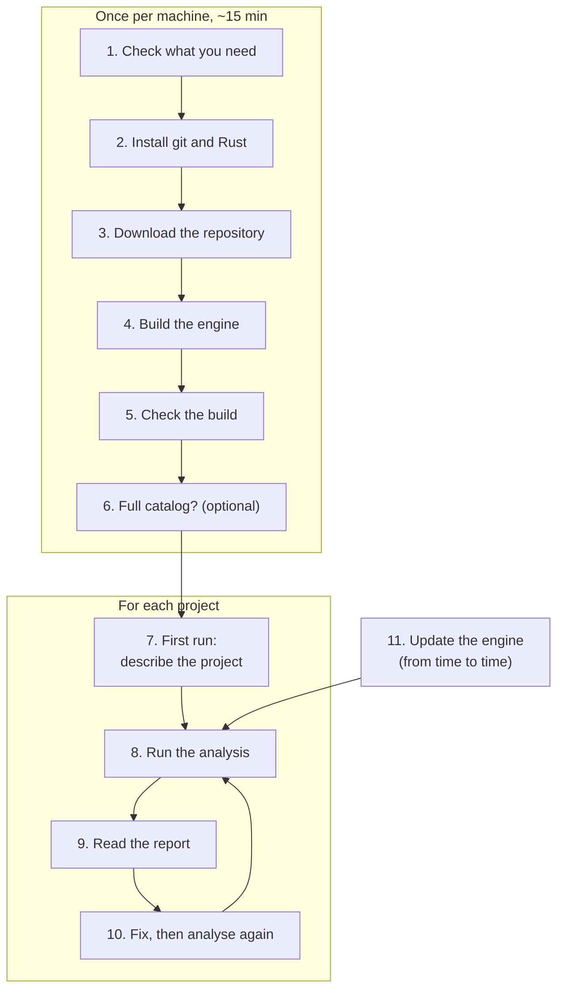
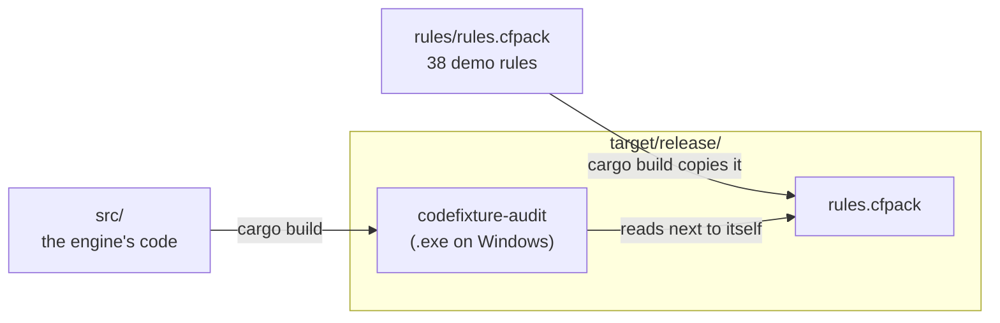
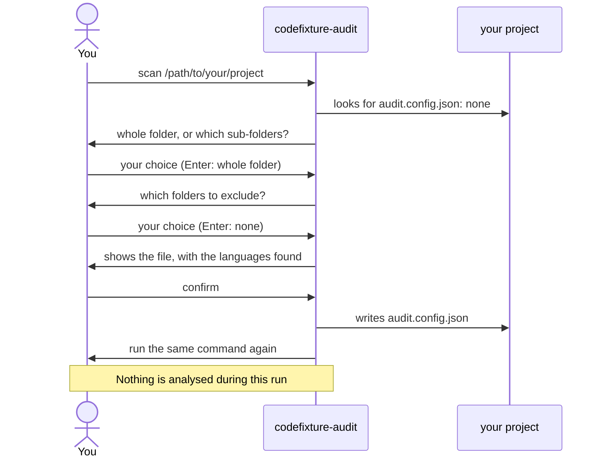
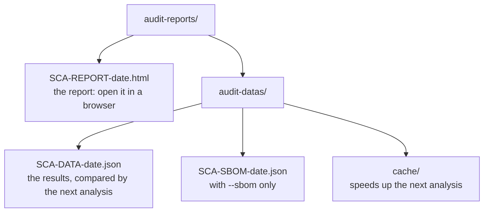
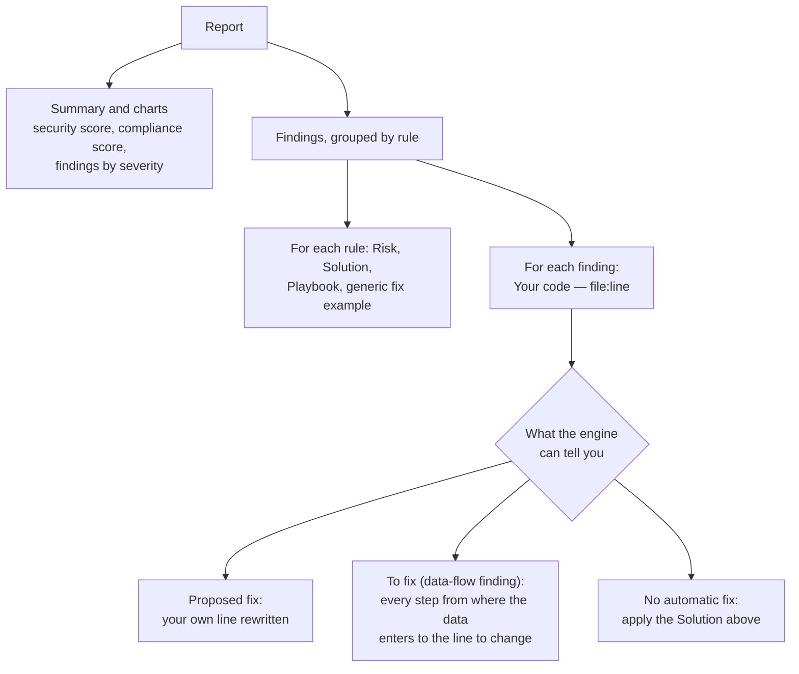
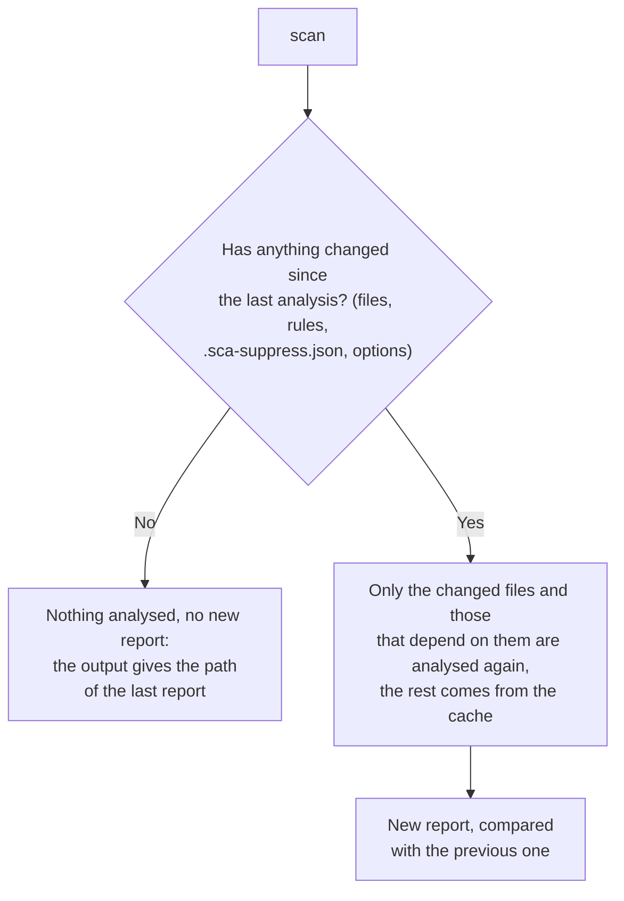
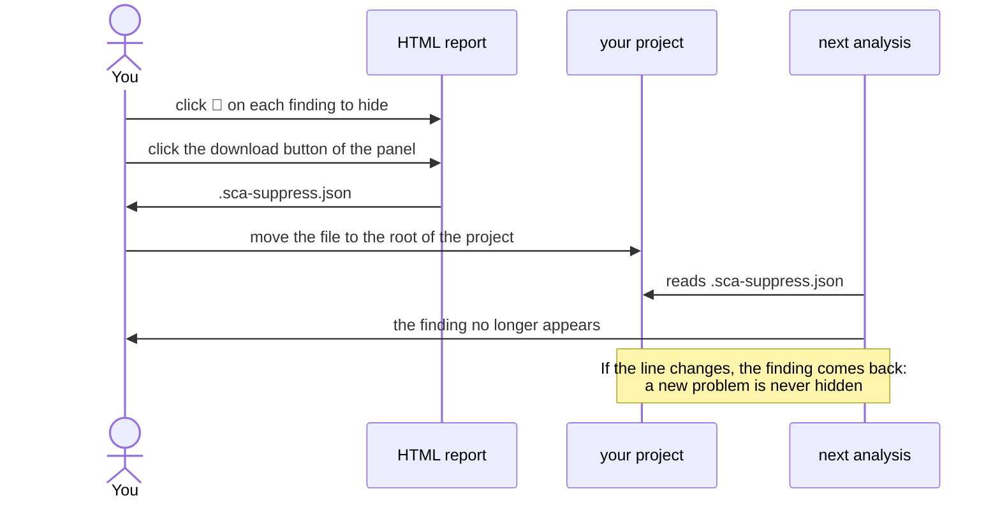
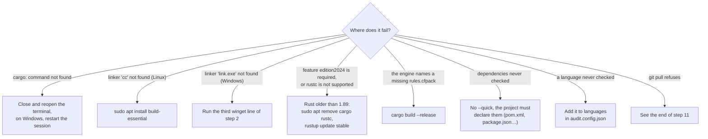

# From download to a full analysis of your code

*Version française : [INSTALLATION.fr.md](INSTALLATION.fr.md)*

This guide takes you, step by step, from nothing installed to a complete analysis of your own source code on your machine, then through reading and fixing what it finds. The analysis runs locally: your code never leaves your computer.



| Step | What you do | Time |
|---|---|---|
| [1](#step-1-check-what-you-need) | Check what you need | 1 min |
| [2](#step-2-install-the-tools) | Install the tools (`git`, Rust) | 5–10 min, once |
| [3](#step-3-download-the-repository) | Download the repository | 1 min |
| [4](#step-4-build-the-engine) | Build the engine | 3–10 min the first time |
| [5](#step-5-check-the-build) | Check the build | 1 min |
| [6](#step-6-add-the-full-catalog-optional) | Add the full catalog (optional) | 1 min to read |
| [7](#step-7-describe-your-project-first-run) | Describe your project (first run) | 2 min, once per project |
| [8](#step-8-run-the-analysis) | Run the analysis | seconds to a few minutes |
| [9](#step-9-read-the-report) | Read the report | — |
| [10](#step-10-fix-and-analyse-again) | Fix and analyse again | — |
| [11](#step-11-update-the-engine) | Update the engine | 2 min |

Read [Known limits](#known-limits) first: the engine is tested on macOS and Linux, not yet on Windows, and the first analysis of a project takes two runs.

Commands are given for macOS and Linux (Terminal) and Windows (PowerShell). Replace `/path/to/your/project` (or `C:\path\to\your\project`) with the folder of the code you want to analyse.

## Known limits

These are the cases where the engine may not behave as you expect, with what to do.

- **Not yet tested on Windows.** Every step of this guide was run on macOS, and on Linux (Ubuntu 24.04). The Windows commands are given, but you may be the first to run them. If a step fails, note the command and the full message it printed, and send them to CodeFixture.
- **The first analysis takes two runs.** The first time you analyse a project, the engine asks what to analyse (step 7), writes `audit.config.json`, and stops without a report. This is expected: run the same command again. In a script or a CI job there are no questions and the first run produces the report.
- **The demo rules give a thin report.** The 38 demonstration rules of this repository cover a small part of what the engine detects. On a real project their findings may come mostly from a few rules, such as JavaScript written in HTML attributes (`onclick=…`). The full catalog (step 6) gives the complete report.
- **The demo pack knows few published vulnerabilities.** Your dependencies are compared with the published vulnerabilities the rule pack carries: 21 well-known ones in this repository's pack (Log4Shell, Spring4Shell, lodash, lxml…). A dependency the report does not name may still be affected by another one. The full catalog (step 6) checks them against every published vulnerability of the five ecosystems, as of the day its data was last downloaded.
- **Some findings have no automatic fix.** When the engine cannot rewrite your line safely, the report says so and gives the solution in words, with a generic example. Fixing the line is then up to you.
- **A finding can be a false positive.** If a finding is wrong (the value is already checked, or cannot come from a user), hide it with 🚫 (step 10) and report it: it helps improve the rules.
- **First installation takes time.** Installing Rust and the first build take about 10 to 15 minutes (steps 2 and 4). Later builds and analyses are much faster; a re-run on an unchanged project takes less than a second and writes no new report.

## Step 1: check what you need

- macOS 12 or later, Linux (tested on Ubuntu 24.04), or Windows 10/11.
- About 6 GB of free disk space: the build writes about 5 GB of intermediate files into `target/`.
- An internet connection for steps 2, 3 and 11 only. The analysis itself makes no network call.

## Step 2: install the tools

Two tools are used: `git` downloads the repository and its updates, `cargo` (Rust) builds the engine from the code.

**macOS**, in the **Terminal** app:

```bash
xcode-select --install
curl --proto '=https' --tlsv1.2 -sSf https://sh.rustup.rs | sh
```

`xcode-select` installs `git` with the Apple developer tools. The `curl` line installs Rust: press Enter when it asks which installation to use.

**Linux** (Debian, Ubuntu), in a terminal:

```bash
sudo apt install build-essential git curl
curl --proto '=https' --tlsv1.2 -sSf https://sh.rustup.rs | sh
```

`build-essential` brings the C compiler the build needs: without it, step 4 stops on `linker 'cc' not found`. On another distribution, install its C compiler package (`gcc`), `git` and `curl`.

Do not use the `cargo` and `rustc` packages of your distribution: Ubuntu 24.04 ships Rust 1.75, and the engine needs Rust 1.89 or later. If they are installed, remove them first with `sudo apt remove cargo rustc`: they sit in `/usr/bin` and would run instead of the Rust that rustup installs.

**Windows**, in **PowerShell**:

```powershell
winget install Git.Git
winget install Rustlang.Rustup
winget install Microsoft.VisualStudio.2022.BuildTools --override "--wait --passive --add Microsoft.VisualStudio.Workload.VCTools --includeRecommended"
```

The third line installs the C++ build tools Rust needs on Windows.

Then **close and reopen** the terminal or PowerShell, so that it finds the new tools. Check:

```bash
git --version
cargo --version
```

Each command prints a version number. `cargo --version` must print 1.89 or later: an older version comes from another installation of Rust (`which -a cargo` lists them); remove it, then run `rustup update stable`. If one says "command not found", reopen the window again; on Windows, restart the session.

## Step 3: download the repository

```bash
cd ~
git clone https://github.com/ka8t/codefixture-audit-public.git
cd codefixture-audit-public
```

`git clone` copies the repository into a new folder, `codefixture-audit-public`, in your home folder. Every following command runs from that folder.

## Step 4: build the engine

```bash
cargo build --release
```

The first build downloads the Rust libraries the engine uses and compiles everything: 3 to 10 minutes depending on the machine. It ends with a `Finished` line. The engine is then `target/release/codefixture-audit` (`target\release\codefixture-audit.exe` on Windows), next to the rule pack `target/release/rules.cfpack`.



## Step 5: check the build

macOS and Linux:

```bash
./target/release/codefixture-audit --version
./target/release/codefixture-audit list-rules | head -1
```

Windows:

```powershell
.\target\release\codefixture-audit.exe --version
.\target\release\codefixture-audit.exe list-rules | Select-Object -First 1
```

`--version` prints the build, for example `codefixture-audit 0.1.0+42.c5be809`: the commit count and short commit hash say exactly which code you built. Every analysis prints it on its first line too. `list-rules` prints the number of rules on its first line: 38 for the demonstration rules this repository ships.

Every command below is run from the `codefixture-audit-public` folder, with the engine's full path.

## Step 6: add the full catalog (optional)

With the 38 demonstration rules, the analysis works at once but covers a small part of what the engine detects. The full catalog has more than 700 rules. It also covers every published vulnerability (CVE, GHSA) of the five ecosystems, against which your dependencies are checked.

The full catalog is not a file to add to this repository. A tester or a client of [CodeFixture](https://codefixture.com) is given access to its private repository on GitHub. Clone that repository and follow its own `docs/INSTALLATION.md`. Its build writes the full catalog next to the engine. Its step 7 downloads the published vulnerabilities onto your machine. Its updates are `git pull` and a new build, as in step 11.

Without that access, keep this repository: the steps below work the same with the demonstration rules.

## Step 7: describe your project (first run)

The first time you analyse a project, the engine asks you what to analyse and writes the answer into `audit.config.json`, at the root of the project:

macOS and Linux:

```bash
cd ~/codefixture-audit-public
./target/release/codefixture-audit scan /path/to/your/project --lang en
```

Windows:

```powershell
cd ~\codefixture-audit-public
.\target\release\codefixture-audit.exe scan C:\path\to\your\project --lang en
```



It asks whether to analyse the whole folder or some sub-folders, and which folders to exclude. It then shows the file with the languages it detected, and writes it once you confirm. Nothing is analysed during this step: run the same command again for the analysis (step 8).

The file looks like this; you can edit it by hand at any time:

```json
{ "languages": ["python", "javascript"], "paths": { "include": ["src/"], "exclude": ["src/legacy/"] } }
```

- `languages`: the languages checked. Accepted values: `python`, `java`, `javascript`, `typescript` (same rules as `javascript`), `php`, `csharp`, `html`, `yaml`, `dockerfile`; the Dockerfile rules are always added. If you later add code in another language, add it here: until then, every analysis warns that those files are checked by no rule.
- `paths.include` and `paths.exclude`: the folders analysed and skipped.

The questions are asked only in an interactive terminal. In a script or a CI job, the engine analyses the whole folder without asking.

## Step 8: run the analysis

For a complete analysis, in English:

macOS and Linux:

```bash
cd ~/codefixture-audit-public
./target/release/codefixture-audit scan /path/to/your/project --lang en
```

Windows:

```powershell
cd ~\codefixture-audit-public
.\target\release\codefixture-audit.exe scan C:\path\to\your\project --lang en
```

For a report in French, Spanish or German, replace `--lang en` with `--lang fr`, `--lang es` or `--lang de`.

- `--lang` sets the language of the report: `en`, `fr`, `es` or `de`.
- When your project declares dependencies (`requirements.txt`, `package.json`, `pom.xml`, `composer.json`…), their versions are compared with the published vulnerabilities the rule pack carries, offline; the output names the pack, the date of its data and its counts. The version compared is the one the lockfile next to the manifest gives (`package-lock.json`, `poetry.lock`, `composer.lock`…), else the exact version the manifest pins, else the lowest version a range allows (`>=2.0` gives 2.0), which the finding states with the range. A constraint without a lower bound, such as `<2.0`, is reported as unpinned. Maven, Gradle and NuGet dependencies are compared only when their version is exact. The packages a lockfile installs besides the declared ones are compared too. In the finding, each vulnerability gives its severity, then `exploited in attacks, CISA KEV since <date>` when CISA's catalog of Known Exploited Vulnerabilities lists it, and `EPSS <n>%`, FIRST's probability that it gets exploited in the next 30 days. An exploited vulnerability makes the finding critical, whatever its severity; the EPSS score changes nothing. The databases of this data and their licenses are listed in the report's scope table and in the [README](README.md#vulnerability-data).
- `--sbom` also writes the list of your declared dependencies as a CycloneDX file: see [SBOM export](#sbom-export).

The terminal shows the progress, what was loaded and a summary. Here, the analysis of OWASP Juice Shop with this repository's demonstration rules:

```text
[codefixture-audit] codefixture-audit 0.1.0+54.171ec77
[codefixture-audit] Scope (audit.config.json): include the whole project; exclude 7 default patterns
[codefixture-audit] Analysis in progress...
…
[codefixture-audit] Rules: 23/38 rule file(s) kept for the project's languages, from the pack /…/target/release/rules.cfpack
[codefixture-audit] 23 rule(s) loaded for languages: dockerfile, html, javascript, python, yaml
…
[codefixture-audit] Version rules: 26 published vulnerabilities from the rule pack /…/target/release/rules.cfpack, OSV data up to 2026-11-18T12:11:06.983073747Z: Maven 5, NuGet 3, Packagist 3, PyPI 10, npm 5.
[codefixture-audit] Report generated : /path/to/your/project/audit-reports/SCA-REPORT-2026-11-20-13-17.html
[codefixture-audit] 871 file(s) scanned, 91999 line(s) of code, 31 finding(s)
```

Options are added to the same command, for example `./target/release/codefixture-audit scan /path/to/your/project --lang en --no-cache`:

| Option | Effect |
|---|---|
| `--lang en\|fr\|es\|de` | language of the report |
| `--no-cache` | analyses everything again (see step 10) |
| `--format sarif` | writes a SARIF file instead of the HTML report, for an IDE or a code platform; it is printed to the terminal, redirect it with `> result.sarif` |
| `--exclude 'tests/'` | skips more files (repeatable) |
| `--only-category security` | analyses one category only (the list: `./target/release/codefixture-audit list-rules`) |
| `--quick` | skips the dependency check, for a faster run |
| `--rules <file>` | uses another rule pack than the one next to the engine |

## Step 9: read the report

Open the file named on the `Report generated` line in a browser. The report is written into your project, under `audit-reports/`; do not commit that folder, it holds the results.





The report starts with a summary and charts, then lists the findings by severity, category and rule. For each rule, a shared block explains:

- **Risk**: what can go wrong;
- **Solution**: how to fix it;
- **Playbook**: the steps to find, fix and check;
- **Generic fix example**: a before/after example written for the rule, not for your code.

Then each finding shows, in this order:

1. **Your code — `file:line`**: the line found in your project, highlighted, with the lines around it.
2. One of these three:
   - **Proposed fix**: your own line rewritten, when the rule knows a safe rewrite. A note says when to adapt it (for example `type="submit"` for a button that submits a form);
   - **To fix**, for a data-flow finding: every step from where the data enters (for example an HTTP parameter) to the line where it is used, each with its file, line and code, the line to change, and what to do there;
   - **No automatic fix for this rule**: apply the Solution above; the generic example shows the idea.

The 🚫 button on a finding marks it as a false positive or an accepted risk; see step 10.

## Step 10: fix and analyse again

Fix your code, then run the same command as in step 8. Each analysis keeps a copy of its results in `audit-reports/audit-datas/` and compares with the previous one: the report shows what was fixed, what is new and what remains.



The next analysis is much faster: it only redoes the files you changed and those that depend on them, and reuses the rest from `audit-reports/audit-datas/cache/`. Two lines of the output say how much was redone, for example `Cache (python): 1/460 file(s) changed since the last scan, 34/10580 taint analyses redone.` The report is the same as with a full analysis. Each version of the engine keeps its own cache in a sub-folder named after it, so two versions used on the same project do not overwrite each other; the three most recently used are kept. To force a full analysis, add `--no-cache`; deleting the `cache/` folder does the same.

If no file has changed since the last analysis, nothing is analysed and no new report is written. The output says so and gives the path of the last report, for example `No file has changed since the scan of 18/11/2026 13:36: nothing was analysed again.` A changed file, rule pack, `.sca-suppress.json` or option runs the analysis again. `--format sarif` and `--format text` still print their result, taken from the last analysis, and `--sbom` gives the path of the SBOM already written instead of writing a new one.

To silence a finding you have reviewed:



1. click 🚫 on the finding in the report (as many as needed), then the download button in the panel that appears: it saves a `.sca-suppress.json` file;
2. move that file to the root of your project.

The next analyses read it by themselves.

A suppression applies to that rule, file and line content: if the line changes, the finding comes back, so that a new problem is never hidden.

## Step 11: update the engine

From the `codefixture-audit-public` folder:

```bash
git pull
cargo build --release
```

`git pull` downloads only the new commits; `cargo build --release` rebuilds the engine, faster than the first time. Check with `--version`: the commit count must have grown.

If `git pull` refuses because of local changes, `git stash` sets them aside and `git pull` then works (`git stash pop` brings them back). To match GitHub exactly and drop your local edits for good: `git fetch origin` then `git reset --hard origin/main`.

## Reference

### Folders an analysis skips

Besides `node_modules/`, `vendor/`, `.venv/`, `__pycache__/`, `*.min.js` and the engine's own reports, an analysis skips folders that hold no project code:

- build output: a `target/` folder next to a `pom.xml` (Maven), a `build/` folder next to a `build.gradle` or `build.gradle.kts` (Gradle);
- Python virtual environments, whatever their name: any folder holding a `pyvenv.cfg` file;
- documentation: `docs/`, `doc/`, `documentation/` and `wiki/`, at any depth and in any case.

After the analysis, one line names each folder skipped this way and why. To analyse one of them anyway, name it in `paths.include` of `audit.config.json`: `"include": [".", "docs/"]`. To skip more folders, list them in `paths.exclude`.

### SBOM export

An SBOM (software bill of materials) lists the third-party packages a project uses, in a standard format that security and compliance tools read. Add `--sbom` to an analysis:

```bash
./target/release/codefixture-audit scan /path/to/your/project --lang en --sbom
```

Besides the report, the engine writes `SCA-SBOM-<date>.json` into `audit-reports/audit-datas/` of your project and prints its path on the `SBOM :` line. The file follows CycloneDX 1.6, the OWASP format:

- one component per dependency declared in `requirements.txt`, `pyproject.toml`, `Pipfile`, `package.json`, `pom.xml`, `build.gradle`, `.csproj` or `composer.json`, with its package URL (`pkg:pypi/requests@2.31.0`);
- one component per package a lockfile installs besides the declared ones (a transitive dependency), with its version;
- a version only when the installed one is known: the version the lockfile gives, else the one the manifest pins exactly. A dependency declared with a range (`flask>=2.0`, `"lodash": "^4.17.0"`) and absent from any lockfile, or without a version, is listed without one;
- no vulnerabilities, hashes or licenses: the vulnerabilities are in the HTML report.

The file prefix `SCA` follows `brand.json` when you customise it.

### Moving the engine

The engine and `rules.cfpack` are all an analysis needs: copy them together to another folder and run the engine from anywhere. Without the pack beside it, the engine stops and names the file it looked for.

### When something goes wrong



| Message or symptom | What to do |
|---|---|
| `cargo: command not found` | close and reopen the terminal (step 2); on Windows, restart the session |
| `linker 'cc' not found` (Linux) | the C compiler is missing: install `build-essential` (step 2) |
| `linker 'link.exe' not found` (Windows) | the C++ build tools are missing: run the third `winget` line of step 2 |
| `feature edition2024 is required`, or `rustc … is not supported` | Rust is older than 1.89: remove your distribution's Rust (`sudo apt remove cargo rustc`), then run `rustup update stable` (step 2) |
| the engine stops and names a missing `rules.cfpack` | run `cargo build --release` again: it puts the pack back next to the engine |
| dependencies are never checked | the project declares none in a file the engine reads (`requirements.txt`, `package.json`, `pom.xml`, `composer.json`, `.csproj`…), or `--quick` was given |
| a language of your project is never checked | add it to `languages` in `audit.config.json` (step 7) |
| `git pull` refuses | see the end of step 11 |

Versions before November 2026 wrote their reports to `docs/audit-reports/`. The first analysis after the upgrade still compares with the last results found there, then writes only to `audit-reports/`; you can delete the old folder afterwards.
