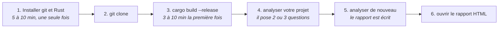
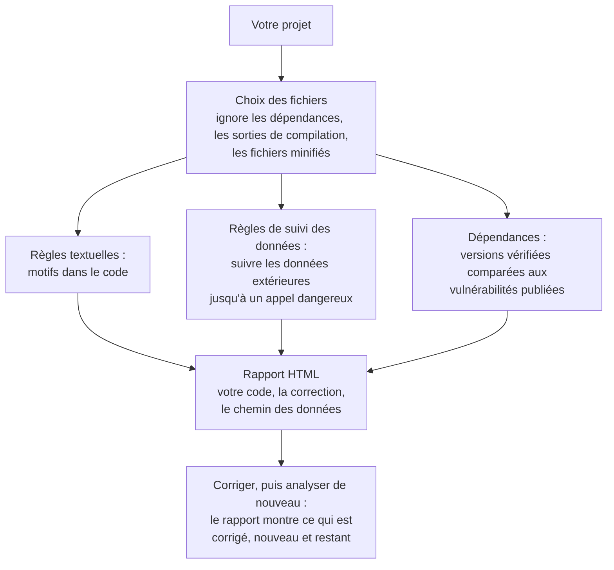
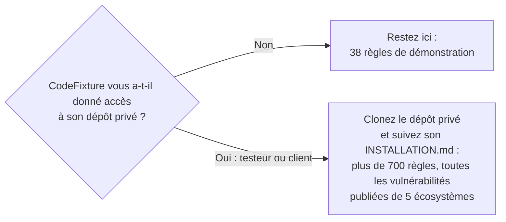

# codefixture-audit

*English version: [README.md](README.md)*

Un analyseur de sécurité du code source, par [CodeFixture](https://codefixture.com). Il lit votre projet, trouve le code qui peut être attaqué (injection SQL, secrets écrits dans le code, dépendances vulnérables…) et produit un rapport HTML qui montre chaque problème sur votre propre ligne, avec sa correction.

- **Rien ne quitte votre machine** : l'analyse n'utilise jamais le réseau.
- **8 langages** : Python, Java, JavaScript/TypeScript, PHP, C#, modèles HTML, YAML (CI/CD) et Dockerfile.
- **Suivi des données (analyse de taint)** : il suit une valeur depuis l'endroit où elle entre dans votre programme (un champ de formulaire, un paramètre HTTP) jusqu'à l'endroit où elle est utilisée de façon dangereuse (une requête SQL), à travers les fonctions et les fichiers.

Ce dépôt contient le moteur complet et **38 règles de démonstration**, un échantillon du catalogue.

## En 10 minutes



macOS, dans le Terminal :

```bash
xcode-select --install
curl --proto '=https' --tlsv1.2 -sSf https://sh.rustup.rs | sh
# close and reopen the Terminal, then:
cd ~
git clone https://github.com/ka8t/codefixture-audit-public.git
cd codefixture-audit-public
cargo build --release
./target/release/codefixture-audit scan /path/to/your/project --lang en
./target/release/codefixture-audit scan /path/to/your/project --lang en
```

Windows, dans PowerShell :

```powershell
winget install Git.Git
winget install Rustlang.Rustup
winget install Microsoft.VisualStudio.2022.BuildTools --override "--wait --passive --add Microsoft.VisualStudio.Workload.VCTools --includeRecommended"
# close and reopen PowerShell, then:
cd ~
git clone https://github.com/ka8t/codefixture-audit-public.git
cd codefixture-audit-public
cargo build --release
.\target\release\codefixture-audit.exe scan C:\path\to\your\project --lang en
.\target\release\codefixture-audit.exe scan C:\path\to\your\project --lang en
```

L'analyse est lancée deux fois volontairement : le premier lancement demande quoi analyser, écrit `audit.config.json` dans votre projet et s'arrête. Le second lancement analyse. Les dernières lignes affichent le chemin du rapport, sous `audit-reports/` dans votre projet : ouvrez-le dans un navigateur.

Linux, le détail de chaque étape et ce qui vous attend : [`INSTALLATION.fr.md`](INSTALLATION.fr.md).

## Ce que fait le moteur



## Limites connues

| Limite | Ce que cela signifie pour vous |
|---|---|
| **Testé sur macOS et Linux** | Linux a été vérifié sur Ubuntu 24.04. Les commandes Windows sont données mais n'ont pas encore été exécutées : merci de signaler tout problème. |
| **La première analyse demande deux lancements** | Le premier lancement pose 2 ou 3 questions (appuyez sur Entrée pour garder les valeurs par défaut), écrit `audit.config.json`, puis s'arrête. Le second lancement produit le rapport. |
| **Les règles de démonstration donnent un rapport maigre** | 38 règles représentent une petite partie du catalogue. La plupart des constats peuvent venir de quelques règles, comme le JavaScript écrit dans les attributs HTML. |
| **Les règles de démonstration connaissent peu de vulnérabilités publiées** | Vos dépendances sont comparées à 21 vulnérabilités bien connues (Log4Shell, Spring4Shell, lodash, lxml…). Une dépendance non signalée peut quand même être touchée par une autre. |
| **La première installation prend du temps** | L'installation de Rust et la première compilation prennent 10 à 15 minutes. Les compilations et analyses suivantes sont bien plus rapides. |

Détails et solutions de contournement : [Limites connues](INSTALLATION.fr.md#limites-connues) dans le guide.

## Commandes courantes

Depuis le dossier `codefixture-audit-public` (sous Windows, `.\target\release\codefixture-audit.exe`) :

| Vous voulez | Commande |
|---|---|
| Analyser un projet | `./target/release/codefixture-audit scan /path/to/your/project --lang en` |
| Un rapport en français, espagnol ou allemand | `--lang fr`, `--lang es` ou `--lang de` |
| Lister les règles | `./target/release/codefixture-audit list-rules` |
| Un SBOM CycloneDX de vos dépendances | ajoutez `--sbom` (voir [Export SBOM](INSTALLATION.fr.md#export-sbom)) |
| Ajouter vos propres règles | des fichiers `.sca` dans `~/.codefixture-audit/custom-rules/` (voir [Vos propres règles](INSTALLATION.fr.md#vos-propres-règles)) |
| Mettre à jour le moteur | `git pull`, puis `cargo build --release` |

Quand votre projet déclare des dépendances (`requirements.txt`, `package.json`, `pom.xml`, `composer.json`, `.csproj`…), leurs versions sont comparées, hors ligne, aux vulnérabilités publiées que portent les règles : la version qu'un fichier de verrouillage indique comme installée (`package-lock.json`, `poetry.lock`, `Pipfile.lock`, `composer.lock`…), sinon la version exacte, sinon la plus petite version qu'autorise un intervalle, que le constat indique. Les paquets qu'un fichier de verrouillage installe en plus des dépendances déclarées sont aussi vérifiés. Une vulnérabilité que la CISA répertorie comme exploitée dans de vraies attaques (KEV) rend le constat critique, et chaque CVE affiche son score EPSS : la probabilité qu'elle soit exploitée dans les 30 prochains jours.

Les règles sont livrées compilées dans un seul fichier, `rules/rules.cfpack`. La compilation le copie à côté du moteur, et les deux peuvent être déplacés ensemble n'importe où.

## Le catalogue complet



Le catalogue complet n'est pas un fichier à ajouter ici : CodeFixture donne à ses testeurs et à ses clients l'accès au dépôt privé qui le compile. Voir l'[étape 6](INSTALLATION.fr.md#étape-6--ajouter-le-catalogue-complet-facultatif).

## Données de vulnérabilités

Les vulnérabilités publiées et les données d'exploitation contenues dans les règles proviennent de ces bases, chacune utilisée selon sa licence :

| Base | Licence |
|---|---|
| [GitHub Advisory Database](https://github.com/github/advisory-database), via [OSV](https://osv.dev) | CC-BY 4.0 |
| [PyPI Advisory Database](https://github.com/pypa/advisory-database), via OSV | CC-BY 4.0 |
| [OpenSSF Malicious Packages](https://github.com/ossf/malicious-packages), via OSV | Apache 2.0 |
| [Drupal security advisories](https://www.drupal.org/security), via OSV | MIT |
| [OSS-Fuzz](https://github.com/google/oss-fuzz-vulns), via OSV | CC-BY 4.0 |
| [Erlang Ecosystem Foundation CNA](https://cna.erlef.org), via OSV | CC-BY 4.0 |
| [FriendsOfPHP security advisories](https://github.com/FriendsOfPHP/security-advisories) | Unlicense |
| [CISA Known Exploited Vulnerabilities](https://www.cisa.gov/known-exploited-vulnerabilities-catalog) | CC0 1.0 |
| [FIRST EPSS](https://www.first.org/epss) | [EPSS usage agreement](https://www.first.org/epss/#Usage-Agreement), mention de la source demandée |

Les enregistrements sont réduits aux noms de paquets et aux versions touchées que le moteur compare. Chaque rapport liste, dans son tableau de périmètre, les bases utilisées par ses règles.

## Licence

Licence d'évaluation propriétaire : voir [`LICENSE`](LICENSE). Vous pouvez compiler et tester le moteur pour l'évaluer ; tout autre usage, y compris au sein d'une entreprise, nécessite un accord avec [CodeFixture](https://codefixture.com).
