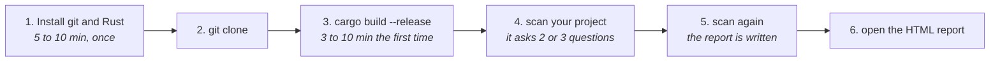
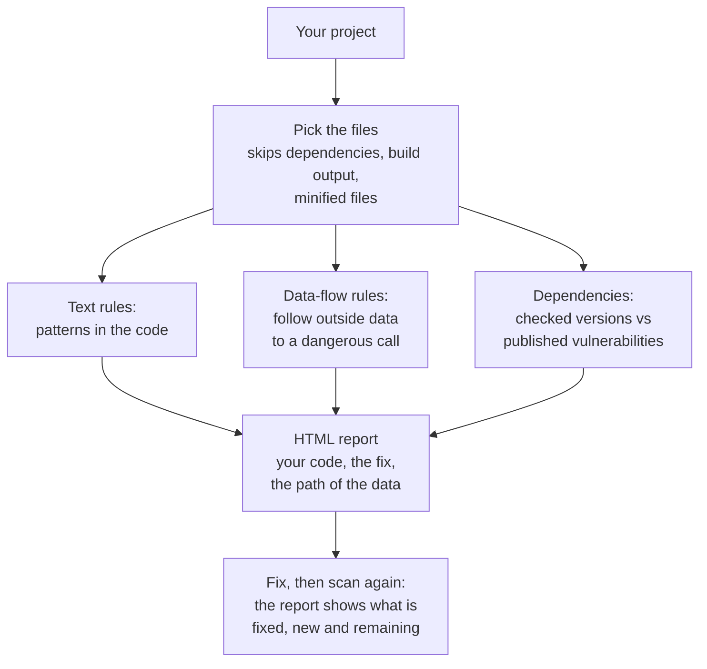
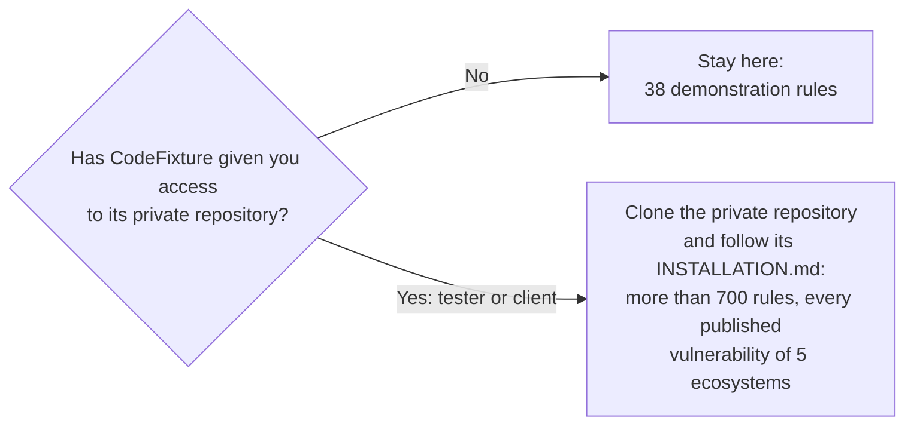

# codefixture-audit

*Version française : [README.fr.md](README.fr.md)*

A security scanner for source code, by [CodeFixture](https://codefixture.com). It reads your project, finds code that can be attacked (SQL injection, secrets written in the code, vulnerable dependencies…) and writes an HTML report that shows each problem on your own line, with the fix.

- **Nothing leaves your machine**: the analysis never uses the network.
- **8 languages**: Python, Java, JavaScript/TypeScript, PHP, C#, HTML templates, YAML (CI/CD) and Dockerfile.
- **Data-flow analysis**: it follows a value from where it enters your program (a form field, an HTTP parameter) to where it is used dangerously (an SQL query), across functions and files.

This repository holds the complete engine and **38 demonstration rules**, a sample of the catalog.

## In 10 minutes



macOS, in the Terminal:

```bash
xcode-select --install
curl --proto '=https' --tlsv1.2 -sSf https://sh.rustup.rs | sh
# close and reopen the Terminal, then:
cd ~
git clone https://github.com/ka8t/codefixture-audit-public.git
cd codefixture-audit-public
cargo build --release
./target/release/codefixture-audit scan /path/to/your/project --lang en
./target/release/codefixture-audit scan /path/to/your/project --lang en
```

Windows, in PowerShell:

```powershell
winget install Git.Git
winget install Rustlang.Rustup
winget install Microsoft.VisualStudio.2022.BuildTools --override "--wait --passive --add Microsoft.VisualStudio.Workload.VCTools --includeRecommended"
# close and reopen PowerShell, then:
cd ~
git clone https://github.com/ka8t/codefixture-audit-public.git
cd codefixture-audit-public
cargo build --release
.\target\release\codefixture-audit.exe scan C:\path\to\your\project --lang en
.\target\release\codefixture-audit.exe scan C:\path\to\your\project --lang en
```

The scan runs twice on purpose: the first run asks what to analyse, writes `audit.config.json` in your project and stops. The second run analyses. The last lines print the path of the report, under `audit-reports/` in your project: open it in a browser.

Linux, the details of each step and what to expect: [`INSTALLATION.md`](INSTALLATION.md).

## What the engine does



## Known limits

| Limit | What it means for you |
|---|---|
| **Tested on macOS and Linux** | Linux was checked on Ubuntu 24.04. The Windows commands are given but have not been run yet: please report any problem. |
| **The first analysis takes two runs** | The first run asks 2 or 3 questions (press Enter to keep the defaults), writes `audit.config.json`, then stops. The second run produces the report. |
| **The demo rules give a thin report** | 38 rules are a small part of the catalog. Most findings may come from a few rules, such as JavaScript written in HTML attributes. |
| **The demo rules know few published vulnerabilities** | Your dependencies are compared with 21 well-known vulnerabilities (Log4Shell, Spring4Shell, lodash, lxml…). A dependency not reported may still be affected by another one. |
| **First installation takes time** | Installing Rust and the first build take 10 to 15 minutes. Later builds and analyses are much faster. |

Details and workarounds: [Known limits](INSTALLATION.md#known-limits) in the guide.

## Everyday commands

From the `codefixture-audit-public` folder (on Windows, `.\target\release\codefixture-audit.exe`):

| You want to | Command |
|---|---|
| Analyse a project | `./target/release/codefixture-audit scan /path/to/your/project --lang en` |
| Report in French, Spanish or German | `--lang fr`, `--lang es` or `--lang de` |
| List the rules | `./target/release/codefixture-audit list-rules` |
| A CycloneDX SBOM of your dependencies | add `--sbom` (see [SBOM export](INSTALLATION.md#sbom-export)) |
| Run it in a CI job | `--quiet`, `--output <file>`, `--metrics-output <file>`, `--log-format json`, `--fail-on-new --baseline <main branch's scan data>` to block only what a change adds, `--fail-on <severity>` and `--max-blocking <N>` to choose what blocks, `--sbom-output <file>` to keep the SBOM under a fixed name, `--format gitlab-sast` for GitLab (listed under `CI/CD` in `scan --help`; see [In a CI/CD pipeline](INSTALLATION.md#in-a-cicd-pipeline)) |
| Leave room on the machine (default: every core but one, 75% of the memory) | `--cpu 50%`, `--max-memory 8` (see [Threads and memory](INSTALLATION.md#threads-and-memory-of-the-analysis)) |
| Add rules of your own | `./target/release/codefixture-audit custom-rules create`, or `.sca` files in `~/.codefixture-audit/custom-rules/` (see [Your own rules](INSTALLATION.md#your-own-rules), and the guide to writing rules, [`RULE-LANGUAGE.md`](RULE-LANGUAGE.md)) |
| Test your rules | `custom-rules test` runs their test cases, `custom-rules try <rule> <project>` runs one on a project |
| Update the engine | `git pull`, then `cargo build --release` |

When your project declares dependencies (`requirements.txt`, `package.json`, `pom.xml`, `composer.json`, `.csproj`…), their versions are compared with the published vulnerabilities the rules carry, offline: the version a lockfile records as installed (`package-lock.json`, `poetry.lock`, `Pipfile.lock`, `composer.lock`…), else the exact version, else the lowest version a range allows, which the finding states. The packages a lockfile installs besides the declared ones are checked too. A vulnerability that CISA lists as exploited in real attacks (KEV) makes the finding critical, and each CVE shows its EPSS score: the probability that it gets exploited in the next 30 days.

The rules come compiled into one file, `rules/rules.cfpack`. The build copies it next to the engine, and the two can be moved anywhere together.

## The full catalog



The full catalog is not a file to add here: CodeFixture gives its testers and clients access to the private repository that builds it. See [step 6](INSTALLATION.md#step-6-add-the-full-catalog-optional).

## Vulnerability data

The published vulnerabilities and the exploitation data in the rules come from these databases, each used under its license:

| Database | License |
|---|---|
| [GitHub Advisory Database](https://github.com/github/advisory-database), through [OSV](https://osv.dev) | CC-BY 4.0 |
| [PyPI Advisory Database](https://github.com/pypa/advisory-database), through OSV | CC-BY 4.0 |
| [OpenSSF Malicious Packages](https://github.com/ossf/malicious-packages), through OSV | Apache 2.0 |
| [Drupal security advisories](https://www.drupal.org/security), through OSV | MIT |
| [OSS-Fuzz](https://github.com/google/oss-fuzz-vulns), through OSV | CC-BY 4.0 |
| [Erlang Ecosystem Foundation CNA](https://cna.erlef.org), through OSV | CC-BY 4.0 |
| [FriendsOfPHP security advisories](https://github.com/FriendsOfPHP/security-advisories) | Unlicense |
| [CISA Known Exploited Vulnerabilities](https://www.cisa.gov/known-exploited-vulnerabilities-catalog) | CC0 1.0 |
| [FIRST EPSS](https://www.first.org/epss) | [EPSS usage agreement](https://www.first.org/epss/#Usage-Agreement), credit requested |

The records are reduced to the package names and affected versions the engine compares. Each report lists the databases its rules used, in its scope table.

## License

Proprietary evaluation license: see [`LICENSE`](LICENSE). You may build and test the engine to evaluate it; any other use, including within a company, requires an agreement with [CodeFixture](https://codefixture.com).
